I wanted to turn a jellyfish I modeled in Blender into pixel art. I looked on YouTube and almost every tutorial runs between 20 minutes and an hour, builds the effect node by node, and spends half the video on the intro. It turns out there are ready-made nodes that do it all in one, and setting them up takes five minutes.

This is the short version: how to make **pixel art in Blender with compositor nodes**, step by step, with a screenshot of every node so you can see the same scene with each effect.

**What you need:**

- **Blender 5.2** or newer. I'm on Blender 5.2.1 LTS.
- A scene with a camera. Mine is an animated jellyfish.
- One of these two node sources (or both):
  - Blender's **official Dithering node**, from the online asset library.
  - **PixelAlchemy**, a node pack by Romasikkk you download on [itch.io](https://romasikkk.itch.io/pixelalchemy).

They aren't the same node, even though both are called Dithering. I explain the difference below.

---

## Step 1: open the Blender compositor and turn it on in the viewport

In the workspace tabs at the top, go to **Compositing**.

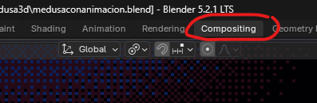

Then, to see the effect live in the viewport without rendering every time, open the **Viewport Shading** menu (the small arrow next to the spheres, top right of the viewport). At the bottom of the menu there's **Compositor**. Set it to **Always**.

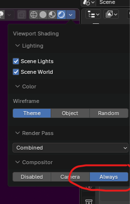

With **Camera** you only see it when you look through the camera. With **Always** you see it all the time, even while you orbit the scene, so you can tweak values and see the change right away.

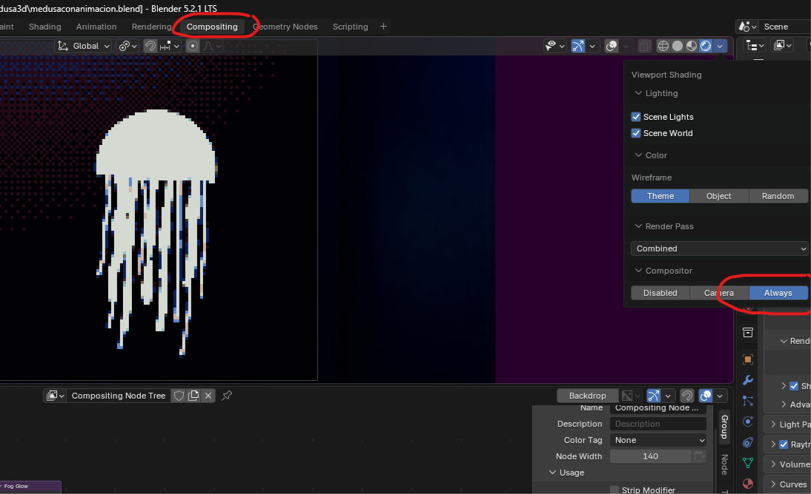

### The preview won't always match the render

Your final render will most likely look a bit different from the viewport preview. Values like Pixel Size are measured in pixels, and the viewport almost never has the same resolution as your render, so the blocks can come out bigger or smaller and the dithering stronger or weaker.

My recommendation: render a frame with `F12`, compare it with the preview, and tweak the values until you get the result you want. It takes a couple of tries.

## Step 2: build the pixel art node chain

Every screenshot in this post uses the same chain:

**Render Layers → Fog Glow → effect node → Group Output and Viewer**

- **Render Layers** is your render. It's already in the compositor.
- **Fog Glow** is the **Glare** node with its type set to Fog Glow. It adds the glow to the jellyfish before it gets pixelated. It's optional, but without it the pixel art looks flatter.
- The **effect node** is the one that turns everything into pixel art. Swap in whichever one you want from the list below.
- **Group Output** is the final output of the render, and **Viewer** lets you see the result behind the node editor.

To add any node: hover over the node editor, press `Shift + A` and search for its name.

## Option A: Blender 5.2's official Dithering node

### How to enable Dithering in Blender

This node doesn't show up until you let Blender connect to the internet, because it comes from the online asset library.

1. Go to **Edit → Preferences → System**.
2. Under **Network**, check **Allow Online Access**.
3. Go back to the compositor, press `Shift + A` and search for **Dithering**. Now it shows up, along with the other assets in the Essentials library.

### What Blender's Dithering looks like

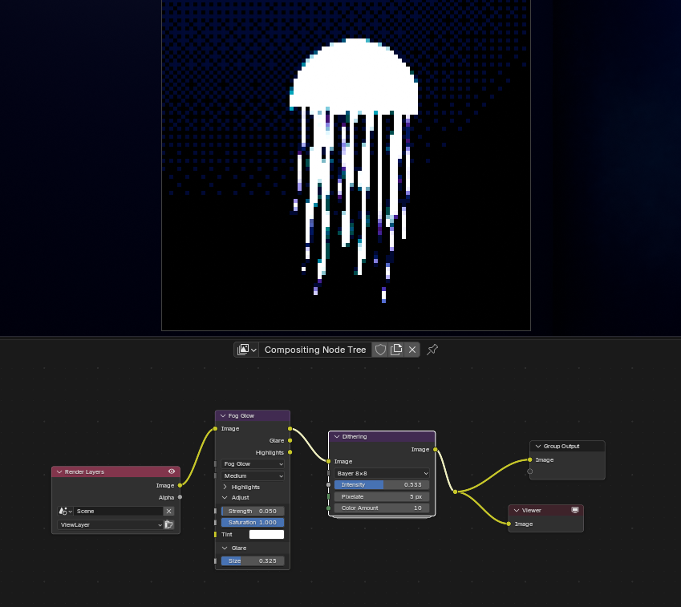

It has four controls and that's it:

- **Pattern type** (I used Bayer 8×8).
- **Intensity:** how much dithering gets applied.
- **Pixelate:** the pixel size. At 5 px it already reads clearly as pixel art.
- **Color Amount:** how many colors are left. At 10 you get a short, high-contrast palette.

If you only want to try the effect without downloading anything, start here.

## Option B: the PixelAlchemy nodes

[PixelAlchemy](https://romasikkk.itch.io/pixelalchemy) is a pack by Romasikkk with seven compositor node groups, including Pixel Art, Dithering, ASCII and CRT. It has more controls than the official node: palettes, noise cleanup, outlines and several pattern types. It needs Blender 5.2 or newer.

### How to install PixelAlchemy

1. Download it from [romasikkk.itch.io/pixelalchemy](https://romasikkk.itch.io/pixelalchemy).
2. In your project go to **File → Append**, open the `.blend` file you downloaded, go into the **NodeTree** folder and pick the nodes you want.
3. In the compositor, `Shift + A` → **Group** and they're there.

### Pixel Art node

The main node. The controls that change the result the most:

- **Palette** and **Colors:** the palette and how many colors it uses (16, 32...).
- **Pixel Size:** the size of each pixel.
- **Dither:** how much dot pattern it mixes between colors.
- **Clean:** how much it cleans up stray pixels.

With Pixel Size at 4, Dither at 0.35 and Clean at 0, it looks like this:

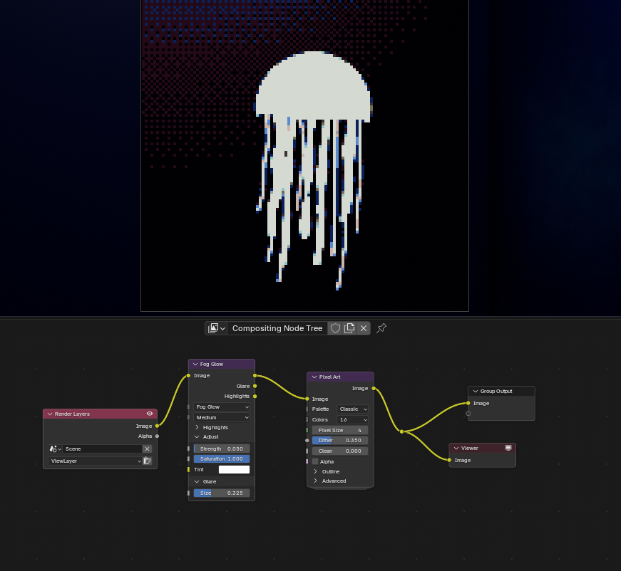

Raising Pixel Size to 5 and Clean to 0.475, the pixels get bigger and there are fewer stray dots on the tentacles:

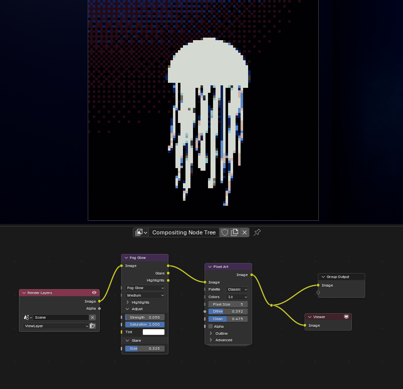

And this is my favorite. I pushed the Fog Glow (Strength 0.883, Size 0.825) and set Pixel Art to 32 colors with Dither at 0.817 and Clean at 0.933. The glow around the jellyfish turns into a gradient of blue and pink pixels:

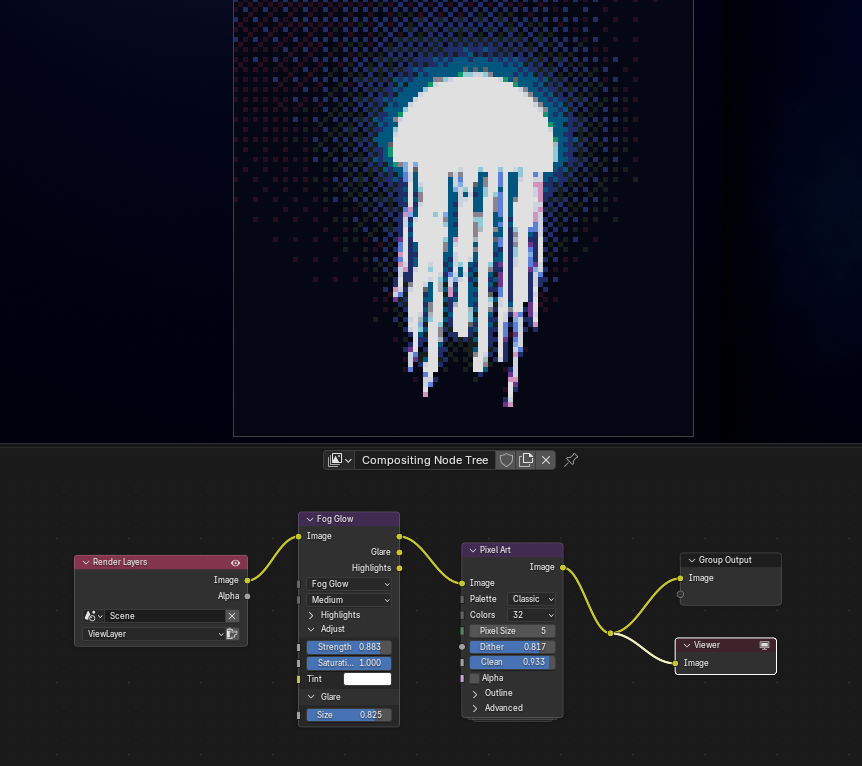

### PixelAlchemy Dithering node

PixelAlchemy's Dithering has more options than the official one: pattern type, color mode, levels, contrast, brightness, saturation and its own palette. With **Color** off and **Levels** at 2 everything goes black and white, like a Game Boy or an old Mac screen:

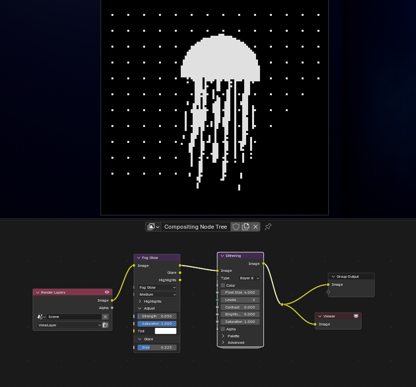

### ASCII node

Turns the render into text characters. **Tile Size** sets the size of each character and **Levels** how many different characters it uses depending on brightness. Exposure and Gamma help the shape read well:

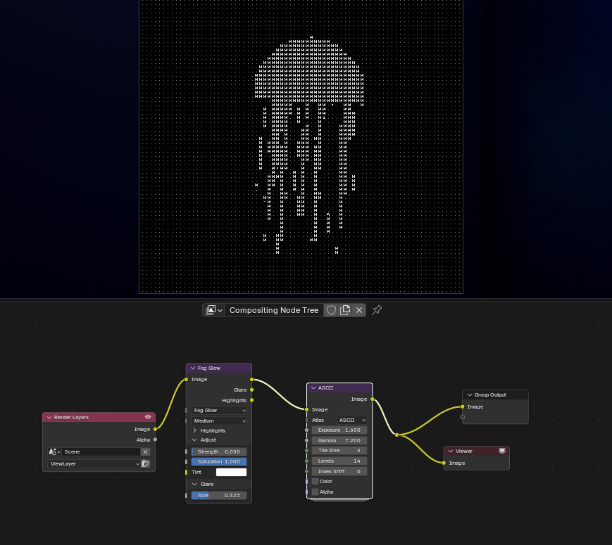

### CRT node

It doesn't pixelate as much as the others, but it fakes an old TV: scanlines, screen curvature, vignette and bloom. It works well on top of a render with a lot of glow:

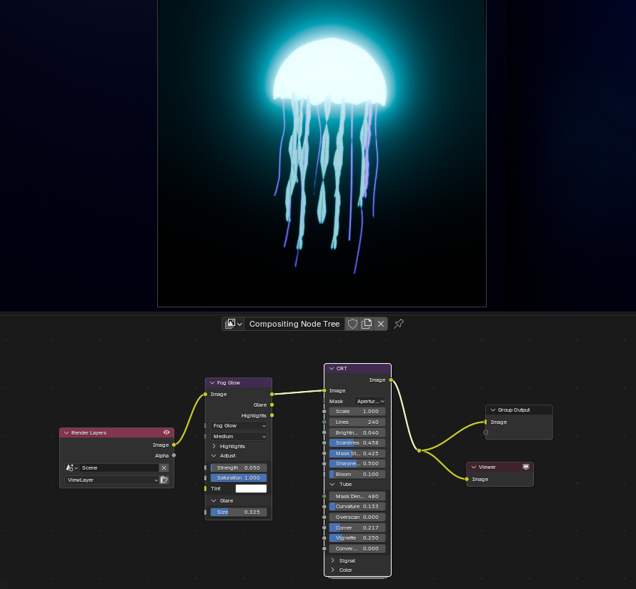

### Display node

Mimics an LCD monitor, with the subpixel grid visible. With **Mask** set to LCD and Pixel Size at 4, the jellyfish looks like it's on a screen seen up close:

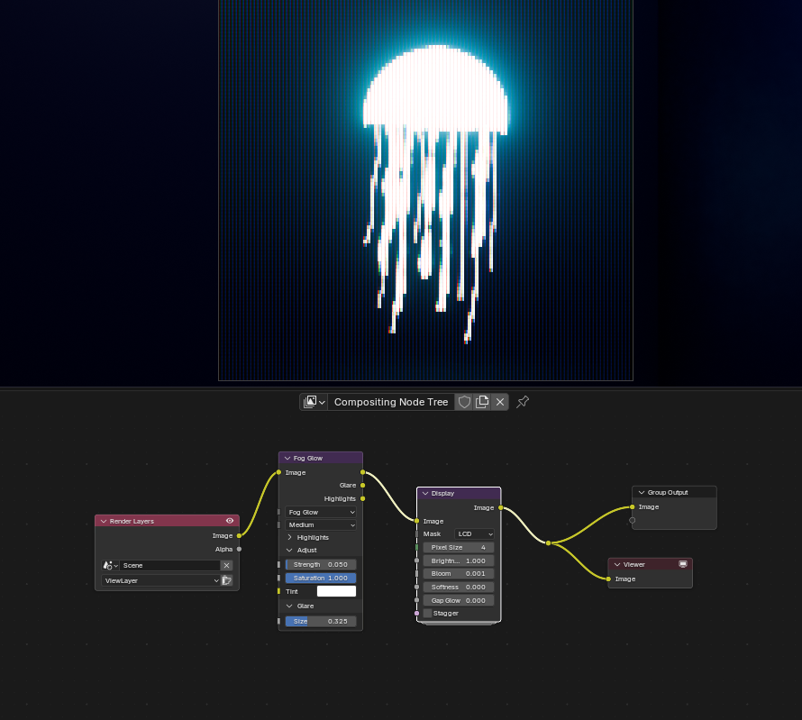

---

## Which pixel art node should you use in Blender?

| Node | Source | What I'd use it for |
|---|---|---|
| Dithering | Blender (online assets) | Trying the effect fast, no download |
| Pixel Art | PixelAlchemy | Color pixel art with palette control |
| Dithering | PixelAlchemy | Black and white or retro with its own palette |
| ASCII | PixelAlchemy | Text character art |
| CRT | PixelAlchemy | Old TV look |
| Display | PixelAlchemy | LCD screen look |

If you've never made pixel art in Blender, start with the official Dithering node to see how the node chain works. When you want control over the palette or cleaner edges, move to PixelAlchemy's Pixel Art. For the jellyfish I kept that one, with the Fog Glow turned up.

## FAQ

### Why can't I find the Dithering node in Blender?

Because it comes from the online asset library. Turn on **Allow Online Access** in **Edit → Preferences → System → Network** and search for it again with `Shift + A` in the compositor.

### Does it work with animations?

Yes. The compositor runs on every frame you render, so if you render the whole animation, every frame comes out as pixel art. My jellyfish is animated and uses this same node chain.

### Do I need to install an add-on?

No. The official Dithering node is already in Blender once online access is on, and PixelAlchemy is a set of node groups you bring into your file with **File → Append**, with nothing to install in the preferences.

More of my 3D work is in [extras](/extras/). And if you try this on your own model, I'd love to see how it turns out.
