My study and art tools were scattered everywhere: an ad-filled site to compress images, another one to merge PDFs, a paid app for planning, and a site that uploaded my files to who knows which server just to remove a background. So I put them all in one place.

**BrainDeck** is a web workbench with 20+ tools for artists, self-learners and creatives. It runs in your browser, needs no account, and everything is processed on your device.

- **Try it:** [mybraindeck.netlify.app](https://mybraindeck.netlify.app/)
- **Source code:** [github.com/GVPV12/braindeck](https://github.com/GVPV12/braindeck)

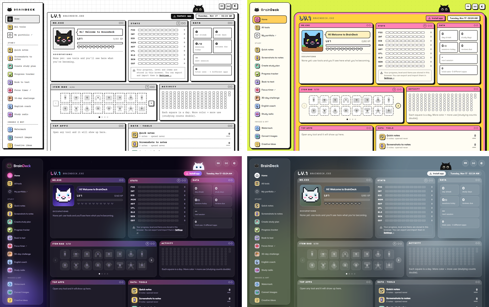

---

## What BrainDeck is

It's a static website: HTML, CSS and JavaScript, with no build step, no backend and no accounts. There's no server keeping your data because there's no server. Your notes, plans and files stay in your browser.

Every tool has its own link, so you can share just one. You can install it as an app from Chrome or Edge, it opens offline after the first visit, and it's available in Spanish and English.

## A home screen that plays like an RPG

The home screen is a dashboard of retro windows. You get an avatar, a level with XP, RPG style stats based on which tools you use, a streak in hearts and a bag of pixel art items you unlock as you go.

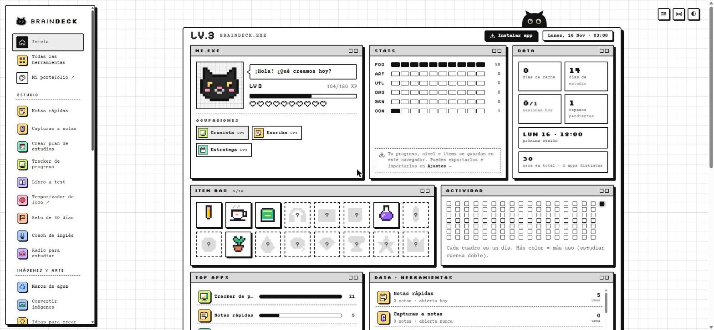

Further down are your most used apps, the data from each tool, and every tool laid out as icons on a device, BrainDeck OS.

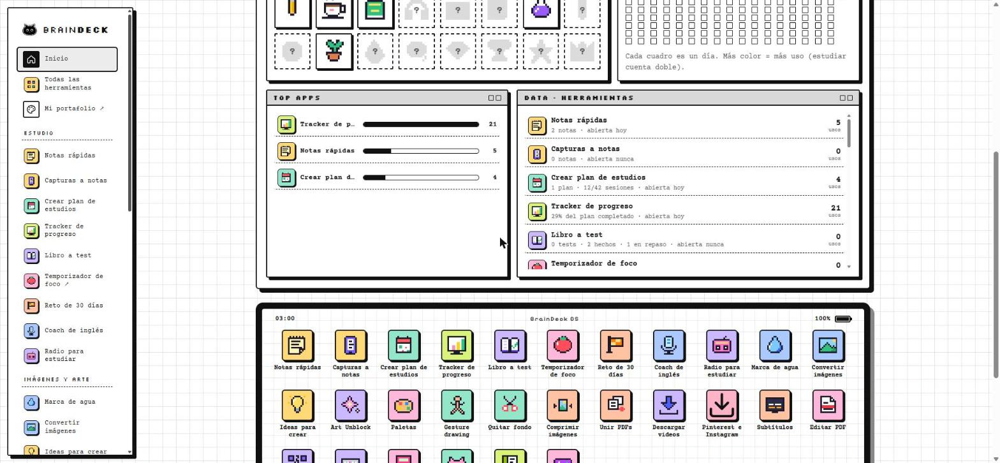

## The tools

**Study:** quick notes, screenshots to notes with OCR, study plan builder, progress tracker, book to test with spaced repetition, 30 day challenge, spoken English coach, study radio, and a shortcut to [FOCUS TIME](/blog/posts/focus-time-gamified-adhd-productivity-app/).

**Images and art:** watermark, convert and resize, compress images, remove background, palette generator, ideas to create, Art Unblock and gesture drawing.

**Utilities:** merge PDFs, edit PDF, video download commands, Pinterest and Instagram, subtitles, QR generator and shortcut finder.

**Money:** commission calculator and savings plan.

## A study planner built for ADHD

This is the part that took the most work. The plan builder turns a list of topics, books or videos into a study and review plan, with an `.ics` file for your calendar app. It has four options, all unchecked by default, because each person picks what works for them:

- **No fixed times:** each session belongs to a day, not an hour. You only see the length, like "≈45 min".
- **One topic per day:** it doesn't mix different books or topics on the same day.
- **Catch-up day:** the last study day of each week stays free so you can catch up.
- **No guilt:** anything pending is "waiting its turn" instead of showing up as overdue.

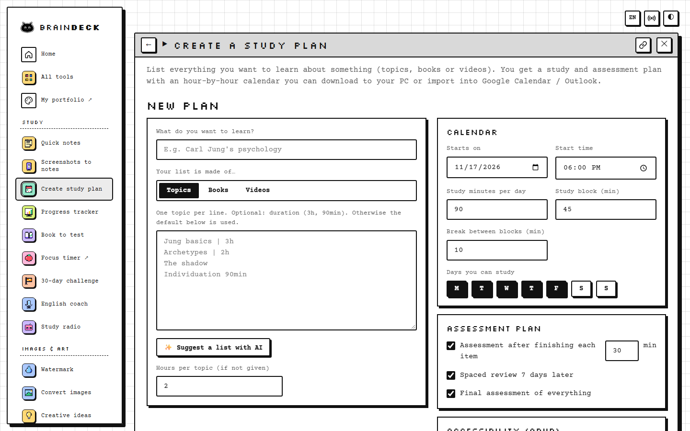

### The tracker: one thing at a time

When you open the tracker, **ahora.exe** ("now.exe") asks how much energy you have today (low, normal or high) and suggests a single task. It prefers that you keep going with what you did last time, so it's easier to get started.

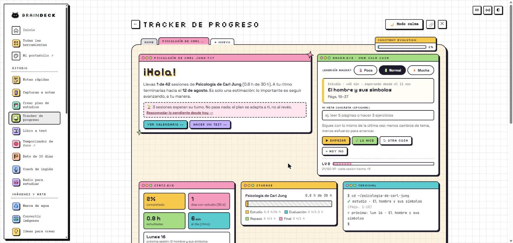

You can write a concrete goal for the session, and the timer stays visible the whole time, with no alarms, because time blindness is real. If today isn't the day, you can leave it for later without penalty. If you fall behind, pending sessions are "waiting their turn" and the app reminds you the plan adapts to you, not the other way around, with a button to reschedule everything pending starting today.

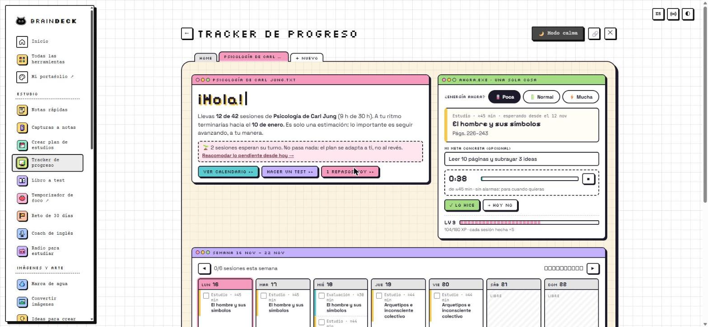

Below that are your hours studied, percentage complete, daily pace and a terminal with what you've done and what's next.

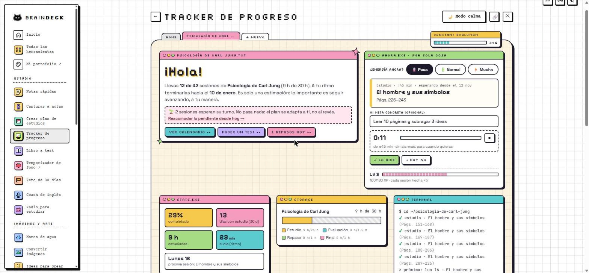

The week view shows each session on its day, and free days are marked as free.

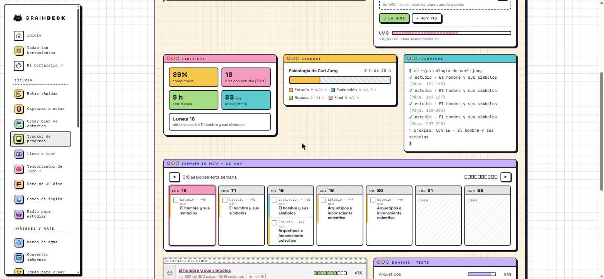

The tests you take in **Book to test** feed the mastery window, which shows how well you know each topic. Next to it are your study notes and an activity calendar.

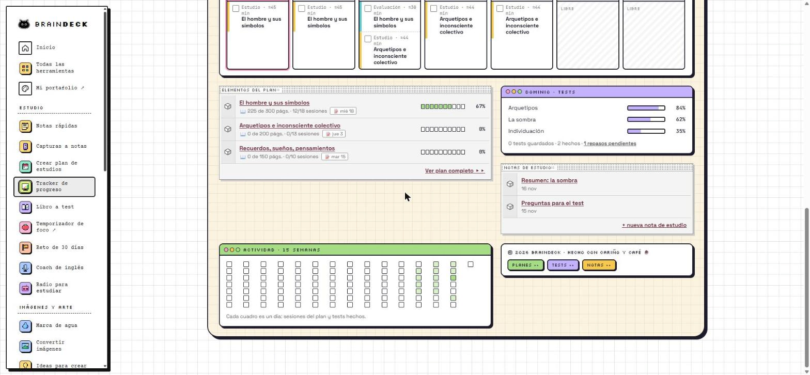

And when you finish, it celebrates.

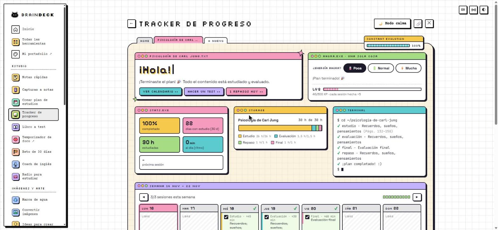

## Tools for artists

As an illustrator, these are the ones I use most:

- **Watermark:** batch watermarks with author metadata (XMP, EXIF and PNG) and a signal that you don't allow AI training on your art. If that's something you care about, I wrote about [how to protect your artwork from AI training](/blog/posts/protect-artwork-from-ai-training/).
- **Palette generator:** from a color, a photo or a word, and it exports to Procreate, Adobe (`.ase`), GIMP, Krita, Blender and CSS.
- **Compress images:** by quality or to an exact size in KB, with a before and after slider. It also strips hidden metadata like GPS location.
- **Remove background:** with AI that runs in your browser, without uploading the image anywhere.

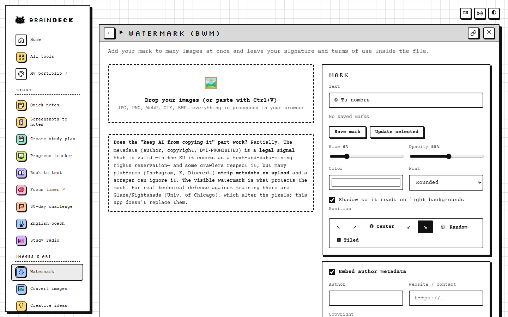

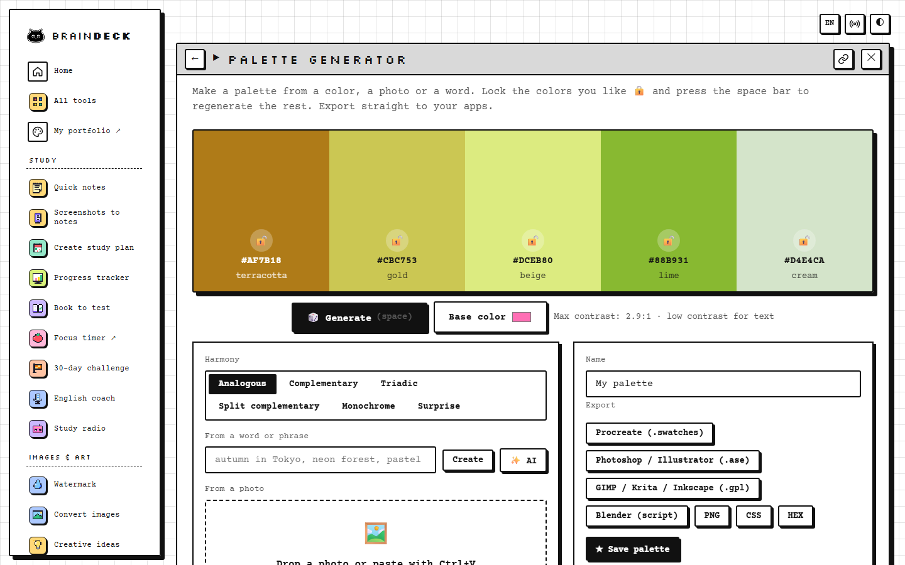

## Everyday utilities

**Edit PDF** reorders, rotates, splits, numbers and signs pages. The **shortcut finder** collects shortcuts for Windows, macOS, Blender, Figma, Photoshop, Krita, Procreate and more, and switches between Ctrl and ⌘ depending on your system.

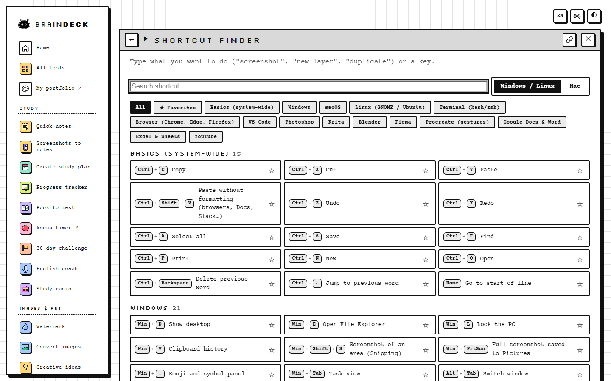

To download videos, Pinterest images or Instagram reels, BrainDeck doesn't send you to an ad-filled download site. It builds the exact [yt-dlp](https://github.com/yt-dlp/yt-dlp) or [gallery-dl](https://github.com/mikf/gallery-dl) command for Windows, macOS or Linux, and you copy it with one button. It's for downloading your own content or content you have permission to use.

## On your phone

On mobile the sidebar becomes a bottom bar, and I tested it at 360, 390 and 768 px wide with nothing overflowing.

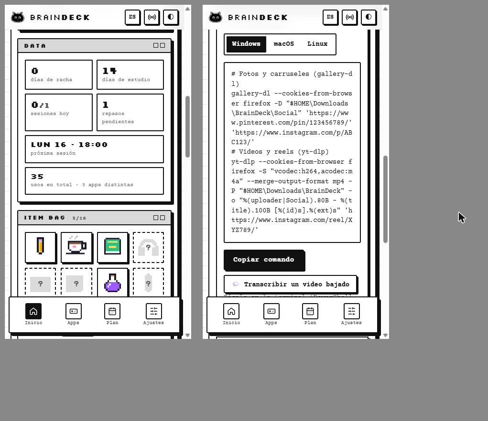

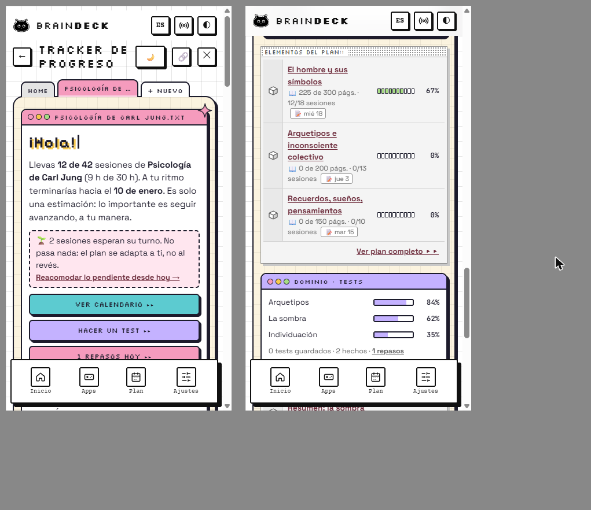

## Four visual styles

Paper is the default, with grid paper and black and white retro windows. There's also Neo pixel, which is neobrutalist, Cosmos, in dark glass, and Frost, in light glass. All four are in the collage at the top, and whichever you pick is remembered on every visit.

## Privacy: your data never leaves your browser

- No server, analytics, cookies or accounts.
- Images, PDFs, audio and notes are processed on your device.
- You can export a **password-encrypted** backup of your data (AES-256-GCM) and import it in another browser, merging it with what you have or replacing it.
- Fonts are served from BrainDeck rather than Google, so opening the app doesn't send your IP to Google.
- A Content Security Policy blocks any script that isn't from BrainDeck or jsDelivr, and libraries are checked against their SHA-384 hash before they're saved.

The **Privacy** page inside the app explains what's stored, where, and which outside services see your IP and when, like the radio stations.

## AI is optional

BrainDeck works without AI. If you want it, there are two more levels:

- **Local AI:** Whisper for transcription, a background removal model and a small language model, all running in your browser with WebGPU (recent Chrome or Edge).
- **Claude:** you add your Anthropic API key in Settings and it's only sent to `api.anthropic.com`. The key is never exported, and you can use it for the session only so it's never saved.

## FAQ

### Is BrainDeck free?

Yes. It's free and the code is open on [GitHub](https://github.com/GVPV12/braindeck).

### Do I need an account?

No. Open the site and start using it. Your progress is saved in your browser, and you can export and import it from Settings.

### Does it work offline?

After the first visit, yes. Tools that depend on the internet, like the radio or AI, need a connection.

### Is it useful if I have ADHD?

I designed it with ADHD in mind: short tasks, one thing at a time, time always visible, rewards instead of punishment and no guilt for falling behind. All of those options are your choice, though, so it works if you don't have ADHD too.

If you use it and something's missing, tell me. BrainDeck started because I needed these tools, and the list keeps growing.
