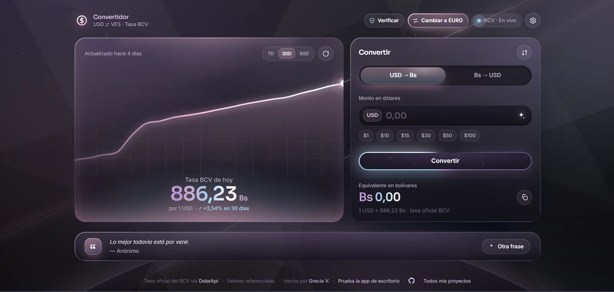
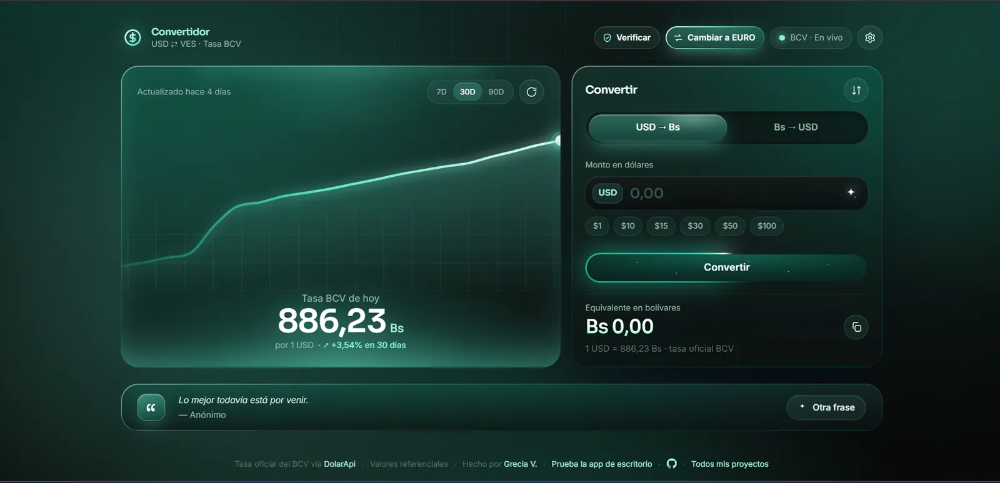
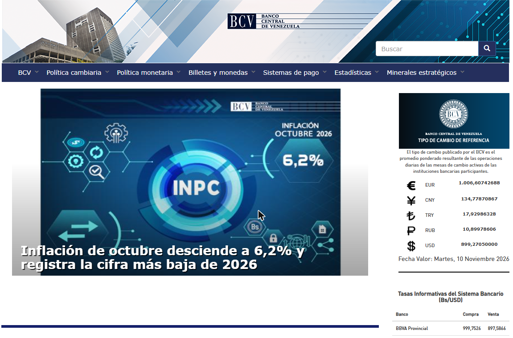
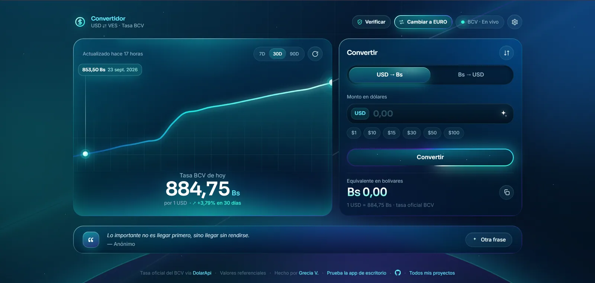

If you live in Venezuela, or you send money to someone who does, converting dollars to bolívars is something you do almost every day. Before paying for groceries, before quoting a client, before sending a mobile payment. And almost always in a hurry, on your phone, standing in a line.

You shouldn't have to install anything for that. A two second conversion doesn't justify an app that takes up space, asks for permissions and fills your phone with notifications. The browser you already have is enough.

So I put together the options that actually work for converting **US dollars and euros to bolívars at the BCV rate** in the browser, with no download, and what's good and bad about each one.

---

## Why a web app and not an installed app

Before the list, here's what made me move my own converter from a desktop app to the web. I started with a [Python version](https://github.com/GVPV12/usdtoves) you had to install on your computer, and I quickly noticed that nobody, me included, opened it for a quick calculation while out.

A web app has some very concrete advantages:

- **It takes up no space.** On a phone short on storage, every installed app counts. A web page takes up nothing.
- **It's always up to date.** No waiting for a store update and nothing to accept. If the rate changes or the app gets better, you see it the next time you open it.
- **It asks for no permissions.** No contacts, no location, no access to your files. A currency calculator doesn't need to know anything about you.
- **It works on any device.** Android, iPhone, your work computer or a relative's. Same link, same app.
- **It runs better on old phones.** Many exchange rate apps load ads and tracking libraries that slow down a phone that's already struggling.
- **It doesn't depend on an app store.** No searching for it, no account to create, no worrying about it being pulled from the store. A website stays at its address.

The only real downside is that you need a connection to see the new rate. Even so, a well built web app can keep the last rate it loaded and show it to you offline, which is what mine does.

## 1. BCV Converter

**Link:** [usdbcv.netlify.app](https://usdbcv.netlify.app/)

I made this one, so obviously it's my favorite, but I made it precisely because the others never quite convinced me. When you open it, the first thing you see is today's BCV rate, big. Next to it is the calculator, which converts as you type, from dollars or euros to bolívars and from bolívars back.

What makes it different:

- **The rate comes from the BCV website.** Every 30 minutes a script reads the official rate straight from bcv.org.ve, so the new rate shows up as soon as it's published, without waiting for a third party API to catch up.
- **Dollar and euro with one button.** The whole app switches between both currencies.
- **Quick amounts** of 1, 10, 15, 30, 50 and 100, the ones most people check.
- **A 7, 30 and 90 day chart** to see whether the rate is climbing.
- **A verify button** that opens the official BCV page, in case you want to compare the number.
- **It works offline** with the last rate it loaded.
- **It can be installed as an app** (PWA) from the browser, no app store needed.
- **No ads**, free, with [open source code on GitHub](https://github.com/GVPV12/convertidor-bcv-web).

And since I'm also a designer, it has three liquid glass skins to choose from. It's a utility, but there's no reason a utility has to look sad.

### It can also be installed as an app (PWA), and it's safe

The BCV Converter is a **PWA** (Progressive Web App): if you want, your browser lets you install it like any other app, with its own icon and its own window, but without going through an app store and without downloading an installer. And it works offline with the last rate it loaded.

Before turning it into a PWA I did a security and privacy review of the code, because installing something on your phone should feel trustworthy. This is what I found and reinforced:

- **It lives inside the browser.** A PWA can't read your files, photos or contacts. It runs with the same limits as any web page, which makes it safer than an APK downloaded from the internet.
- **It asks for no permissions.** The app deliberately blocks the camera, microphone, location and payments, so it couldn't use them even if it tried.
- **It collects no data.** No cookies, no analytics, no tracking, no accounts. The only things it stores on your phone are your preferences (language, skin) and the last rate.
- **It only connects where it needs to.** A security policy tells the browser exactly where the app is allowed to load things from. If someone tried to inject code into it or send data somewhere else, the browser blocks it.
- **The rate is checked before it's published.** The reading from the BCV is compared against a second source, and it's thrown out if they don't match or if it jumps more than 25% at once. A typo on the BCV website, or someone trying to slip in a fake number, never reaches your screen.
- **It never shows an old rate as if it were new.** The rate isn't stored in the app's cache. If you're offline, it tells you with a red dot instead of a green one.
- **The code is open.** Anyone can check exactly what it does on [GitHub](https://github.com/GVPV12/convertidor-bcv-web).

If you're curious about how it's built, I go through it in the [BCV Converter case study](/portfolio/projects/bcv-dollar-bolivar-converter-web-app/).

## 2. The official BCV website

**Link:** [bcv.org.ve](https://www.bcv.org.ve/)

This is the source. Every other tool on this list, mine included, takes the official rate from here, so if you ever doubt a number, this is the page you compare it against.

The problem is that it isn't built for converting. It shows you the day's rate and you do the multiplication yourself. It also doesn't always load fast, and on a phone it looks like a desktop page. It's for checking, not for everyday use.

## 3. Hacé Cuentas

**Link:** [hacecuentas.com](https://hacecuentas.com/ve/finanzas/dolar-y-bolivares)

It has a dollar to bolívar calculator that also adds **VAT (IVA, 16%)** and the **IGTF tax (3%)**, which is really useful if you're working out the final price of a product or putting together an invoice. It also has calculators for euros and USDT.

The downside is that you type the BCV rate in by hand, so you have to look it up somewhere else first. It's better for sums with taxes than for a quick check.

## 4. Google search

Typing "1 USD to VES" into Google gives you a converter instantly, without visiting any page. For a rough idea, it works.

But careful: Google doesn't say where that number comes from, and it doesn't always match the official BCV rate. For charging, paying or quoting in Venezuela, where what matters is the day's official rate, I wouldn't use it.

## 5. Your phone's calculator

The classic plan: look up the rate on the BCV website and multiply it in the calculator. It works, needs nothing extra and is as accurate as the number you copy.

But it's tedious. It's two steps every time: open the BCV website, copy the rate, switch to the calculator and multiply. And if you need to go from bolívars to dollars, you have to divide. It's easy to slip on a decimal when you're in a hurry at the checkout.

With an app that already has the day's rate and converts as you type, you skip all of that. Still, it's everyone's call: if you prefer your usual calculator, it works too.

---

## Quick comparison

| Tool | Official BCV rate | Converts for you | Dollar and euro | Offline |
|---|---|---|---|---|
| BCV Converter | Yes, from bcv.org.ve | Yes, as you type | Yes | Last rate |
| BCV website | Yes, it's the source | No | Yes | No |
| Hacé Cuentas | You type it in | Yes, with IVA and IGTF | Yes | No |
| Google | Not guaranteed | Yes | Yes | No |
| Phone calculator | You copy it | No | Yes | Yes |

## Bookmark it and use it like an app

The trick to making a web app feel like an installed one is having it one tap away. The most practical way is to save it in the bookmarks of the browser you use on your phone, or straight onto your home screen.

**On Android, with Chrome:**

1. Open [usdbcv.netlify.app](https://usdbcv.netlify.app/).
2. Tap the three dot menu in the top right.
3. Tap the star to bookmark it, or **Install app** (some versions say **Add to Home screen**) to get an icon next to your apps.

**On iPhone, with Safari:**

1. Open [usdbcv.netlify.app](https://usdbcv.netlify.app/).
2. Tap the **Share** button, the square with the arrow pointing up.
3. Choose **Add Bookmark**, or **Add to Home Screen** to get an icon on your home screen.

**On a computer:** press `Ctrl + D` (or `Cmd + D` on a Mac) and it's in your bookmarks. In Chrome or Edge you can also install it: an install icon shows up in the address bar, and the app opens in its own window.

With the icon on your home screen you open it like any other app, but without installing anything, without using up storage and always on the newest version.

## Which one do I use?

For everyday use, the [BCV Converter](https://usdbcv.netlify.app/) saved to my home screen. For sums with IVA and IGTF, Hacé Cuentas. And if a number looks off, I check it on the BCV website.

What I wouldn't do is install an app for this. If a web page already does the job, fast, with no permissions and no ads, there isn't much to gain by downloading something.

And if you use another tool that should be on this list, tell me which one.
