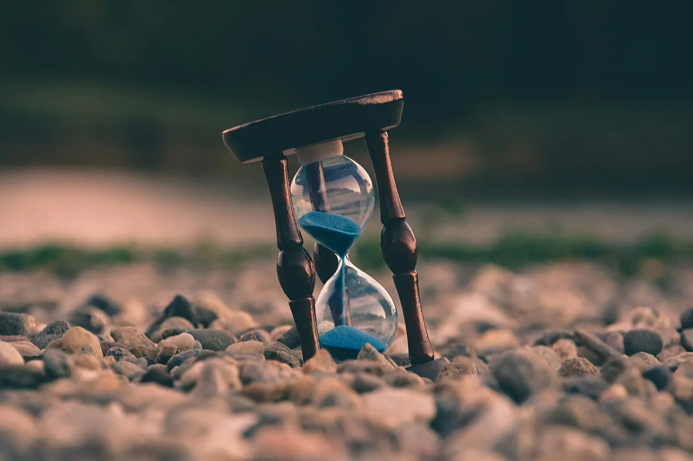
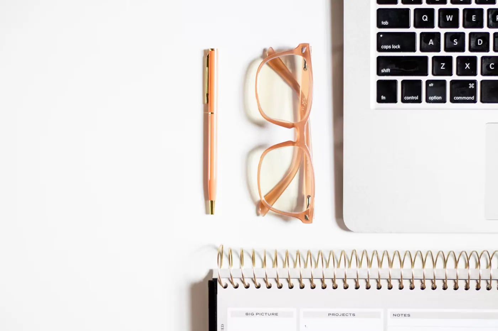
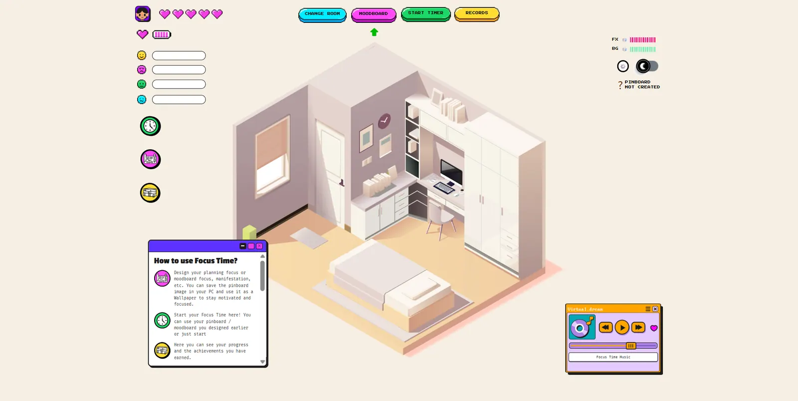
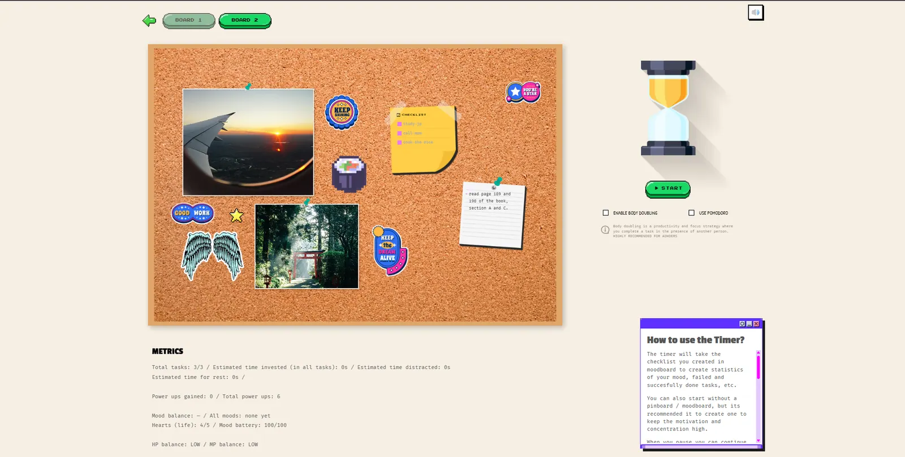
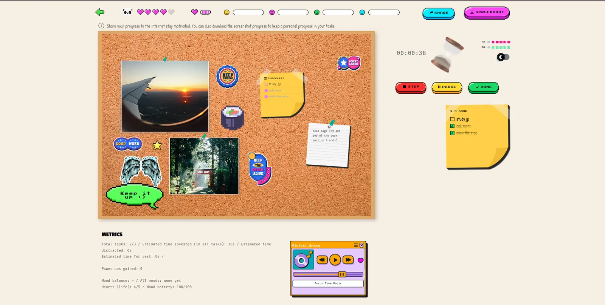
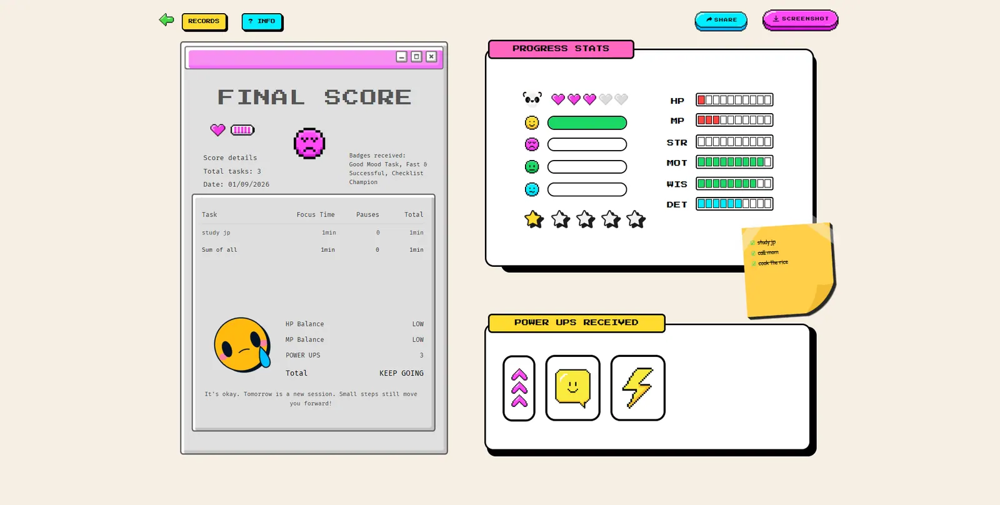
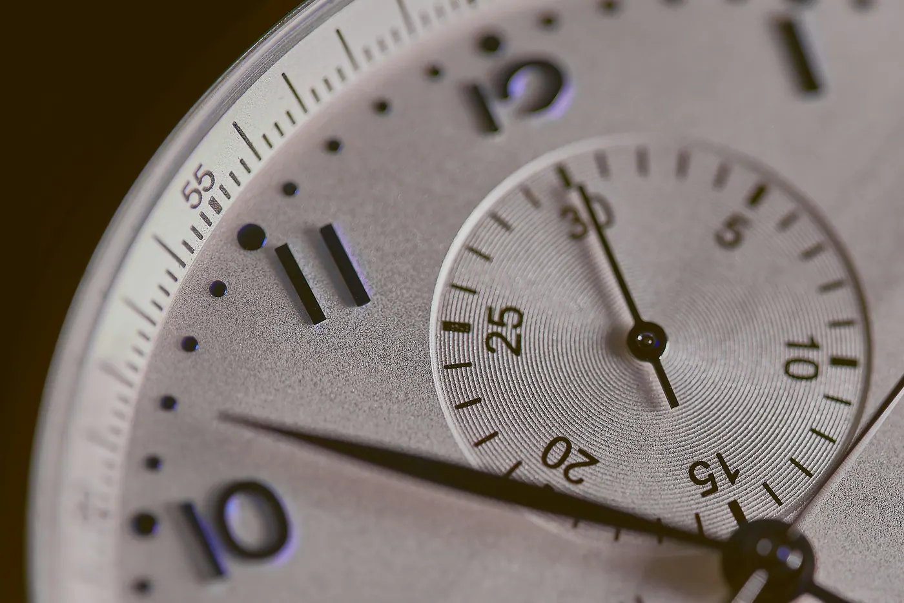

I'm not selling you anything here. Genuinely. It's free, the code is public, and there's no premium tier waiting for you three screens in.

I tried Habitica, Forest, every Pomodoro timer on the planet and every productivity app Instagram decided I needed. None of them lasted more than a week. So I built **FOCUS TIME**, the productivity app I actually wanted, mostly for people with ADHD, and then opened it up to everyone.

- **Try it:** [focustimeisnow.netlify.app](https://focustimeisnow.netlify.app/)
- **Source code:** [github.com/GVPV12/focus-time](https://github.com/GVPV12/focus-time)

---

## Why most productivity apps don't work for ADHD

For a long time digital productivity had one rule: if you do more things in less time, you're being productive. More tasks ticked off. More hours focused. More Pomodoros. More streaks you're terrified of breaking.

That can work for some people. But I kept asking myself what happens when the problem isn't that someone doesn't *want* to be productive, it's that the system they're using doesn't fit how their brain works.

Sometimes you know exactly what you should do and starting is the hard part. Sometimes 25 minutes is perfect and sometimes it isn't. Some people focus fine alone, and some focus a lot better when they feel someone else is working too.

So the question behind FOCUS TIME was the opposite of the usual one: **what if a productivity app adapted to the person, instead of trying to turn the person into a productivity machine?**

## The features, and the ADHD reason behind each one

I didn't want to slap an "ADHD-friendly" label on a normal interface. I wanted those needs to actually shape the design.

- **Moodboards.** The heart of the app. A fully customizable cork board for stickers, images, reminder notes and to-dos, so the goal you're working towards is something you can *see*. It's meant for one-off goals: you build it, use it, and it doesn't ask for constant maintenance.
- **A timer you can feel.** Time blindness is real. Time feels very abstract when you're deep into something, so the timer isn't just a number going down. You link a session to a specific task, and it becomes something tangible.
- **Pomodoro and body doubling.** Pomodoro is there because it works for a lot of people. Body doubling is there because for many ADHD brains, working "next to" someone is the difference between starting and not starting.
- **Mood tracking and ambient audio.** How you feel changes how you work. Logging it is what makes the history useful later.
- **Reminders you can mute.** Specifically so they don't break your hyperfocus, if you're one of those people who can't get it back once it's gone.
- **Sounds tuned for dopamine.** Not just background audio: small sounds on notifications and wins. Moderate dopamine on purpose, enough to pull your attention back without becoming one more distraction.

## An RPG system where resting counts

This is the decision I'm proudest of.

FOCUS TIME uses an RPG-style system: HP, MP, stats, power-ups and progress. But I didn't want gamification to turn into one more version of the "do more" culture. So rest is part of the logic. Your energy matters. Your mood matters. Recovering matters.

The final score of each session **doesn't reward burnout, and it doesn't reward rushing either**. It balances health (HP) and work/rest balance (MP) with how well you actually focused, not how many tasks you crossed off or how fast you did it. Social media trained us to confuse quantity with quality. I didn't want the app to reinforce that.

It ended up feeling less like a competition against yourself and more like a resource management game: the point isn't more points, it's keeping enough in the tank to keep going.

## Your history should teach you something

The records aren't there to show pretty numbers. They're there so you can look back and spot patterns. When do you work best? What kind of sessions do you repeat? How was your mood? Are you trying to do too much?

That's more useful than knowing you finished 17 tasks this week. A productivity app shouldn't only tell you what you did. It can help you understand *how* you work.

And because all of that is personal information, FOCUS TIME has **data export and import**. Your sessions and habits shouldn't feel trapped inside an app. It's a technical detail, but it's also a product decision. (Same reason my [digital commonplace book](/blog/posts/blog-post-commonplace/) lives in plain JSON files.)

---

## From Figma to a working app with AI

I built FOCUS TIME for Contra's 2026 Figma Makeathon, and the process started in Figma: structure, screens, states and interactions. Then came the part I think matters even more than the pretty screens: turning all of that into a specification that could actually be built.

That's where AI came in. I used Claude Code during development, but I never asked it to "make me a productivity app". There were too many rules, states and edge cases for that to work. I had to know exactly what I was building first, and *then* AI could speed up the implementation:

**Figma → specification → AI → code → iteration → working app.**

It's built with React, TypeScript, Tailwind and Zustand, but honestly the most interesting part wasn't the stack. It was finding out how much of the work happens before a single line of code. That's also why I'm wary of "just prompt it" development, which I wrote about in [the vibe coding trap](/blog/posts/vibe-coding-trap/). And if you want AI to build straight into your Figma file, [figma-cli](/blog/posts/figma-cli-free-mcp-no-rate-limit/) is the setup I use.

## Watch the full breakdown

I made a video that goes mechanic by mechanic: which ones are aimed at ADHD brains and which ones at neurotypical ones.

<iframe style="width:100%;aspect-ratio:16/9;border:0;border-radius:12px" src="https://www.youtube-nocookie.com/embed/pKM_wpzLSVk" title="How I Designed a Productivity App That Actually Works for ADHD and Non-ADHD Brains" loading="lazy" allow="accelerometer; clipboard-write; encrypted-media; gyroscope; picture-in-picture" allowfullscreen></iframe>

Short on time (no judgment, it's on brand)? [Here's the short version](https://www.youtube.com/watch?v=H1q0V8ISxkE).

## It's not just an ADHD problem anymore

As someone with ADHD, keeping a hobby or a project alive when it needs constant updates is not easy. My digital garden is the perfect example: I abandon it, come back, abandon it again.

But I'm not the only one with this problem anymore. Social media and the constant stream of things begging for our attention did this to almost everyone's brain. The difference is that people with ADHD have had it forever, and everyone else is picking it up now, thanks to their phones.

That's why FOCUS TIME isn't only for neurodivergent people. It's why Pomodoro is in there, and why the dopamine is moderate instead of a slot machine.

If you're curious about designing for neurodivergent users beyond this app, I went deeper on executive function support in my [gamified EdTech dashboard case study](/portfolio/projects/edtech-dashboard-gamified-ux-design/).

---

## Free, open source and open to contributions

- **Live app:** [focustimeisnow.netlify.app](https://focustimeisnow.netlify.app/)
- **GitHub repo:** [github.com/GVPV12/focus-time](https://github.com/GVPV12/focus-time)
- **Substack (in Spanish):** [Construí FOCUS TIME, una app para TDAH](https://greciart.substack.com/p/construi-focus-time-app-tdah)

The repo is open to contributions if you want to make it better. It also lives in my [side projects](/side-projects/), next to the other tools and games I build when nobody is paying me to.

You don't need to do more to prove your day was productive. Sometimes progress is finishing a task. Sometimes it's focusing for 20 minutes. Sometimes it's stopping before you burn out. And sometimes it's just finding a way to start again.

If you have ADHD, or a productivity app has never survived more than a week with you, I'd love to know: what's the one thing that would make you keep using one?
