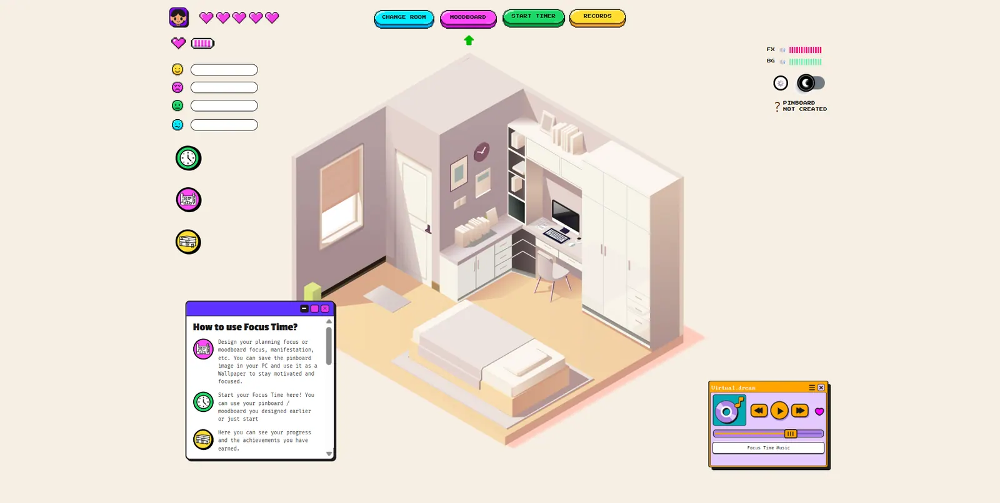

Every post on this blog, this one included, is a `.md` file. No CMS, no editor with a toolbar. I open VS Code, write, and Astro turns the file into the page you're reading.

The first version of this post was a generic cheat sheet. It even listed `==highlight==` and `:smile:` emoji shortcodes, and neither of them works on this site. So I rewrote it around what I actually use, what breaks, and what I learned the hard way.

## What a post looks like before it's a page

Every post starts with frontmatter, the block between the two `---` lines. This is the real one from this post, with the description and alt text shortened:

```markdown
---
layout: /src/layouts/MarkdownPostLayout.astro
title: "Markdown Guide: The Syntax I Actually Use to Write This Blog"
author: Grecia V.
description: "A practical Markdown guide from someone who..."
image:
  url: "/images/posts/markdown.webp"
  alt: "Notebook with the Markdown logo..."
pubDate: 2025-04-05
updatedDate: 2026-11-16
tags: ["SEO & Content", "Developer Tools", "Tutorials & Guides"]
languages: ["markdown", "astro", "html"]
---
```

Frontmatter is YAML, not Markdown, and it does more work than the text below it. On this site:

- `title` and `description` become the `<title>` tag and the meta description Google shows in results.
- `image` is the picture at the top of the post and, after a script crops it to 1200×630, the preview card when someone shares the link.
- `pubDate` and `updatedDate` go into the article's structured data and the sitemap, which is how Google finds out a post changed.
- `tags` and `languages` build the tag pages and pick the related posts at the bottom.

If you get a field wrong, the page still builds. It just builds wrong, and that's harder to notice than an error.

## Headings: start at ##, never at #

```markdown
## A section
### A subsection
```

The layout already prints the title as the page's only `<h1>`. A `# Something` inside the post would make a second one, and then screen readers and search engines get two answers to "what is this page about?"

The table of contents on the side reads every `##` and `###` and builds itself from them, so headings are navigation too. I write them the way someone skimming would look for them: "How to use it on Neocities" instead of "Usage".

## Bold, italic and strikethrough

```markdown
*italic* or _italic_
**bold**
***bold and italic***
~~strikethrough~~
```

I use italic the way I'd stress a word out loud (*somewhere*, *how*) and bold for the one phrase per section that someone skimming should catch. When half a paragraph is bold, nothing stands out.

## Lists

```markdown
- An item
- Another item
  - Nested with two spaces

1. First step
2. Second step
```

Numbers only when the order matters, like install steps. Everything else gets a dash. Pick one bullet character and keep it: switching from `-` to `*` halfway through starts a new list in CommonMark, and you get a gap you didn't ask for.

## Links

```markdown
[how I switched to pnpm](/blog/posts/use-pnpm/)
[Astro docs](https://docs.astro.build/)
```

Internal links get the trailing slash. This site serves every page at one address that ends in `/`, so a link without it costs a redirect, and Search Console files those under "Page with redirect". The link text should say where it goes. "Click here" tells neither the reader nor Google anything.

## Images: two folders, two behaviours

```markdown


```

The first path points to `public/`, and the file is served exactly as I uploaded it. The second goes through Astro's image pipeline, which compresses it and writes its width and height into the HTML so the page doesn't jump while it loads. I use `assets` for screenshots inside a post and `public/` for the cover, because the cover needs a fixed URL for the social card script.

Relative paths start from the `.md` file. The Spanish posts live one folder deeper (`src/pages/es/blog/posts/`), so there the same image is `../../../../assets/blog/...`. Copy a post into the Spanish folder without adding that extra `../` and the build stops because it can't find the image.

For alt text, I describe what's in the picture. The cover of this very post had the alt text of my Tailwind animated border post for months, which is the kind of thing you only find when you go looking.

## Code

Inline code goes between single backticks: `pnpm build`.

Blocks get three backticks and the language name:

````markdown
```bash
pnpm build
```
````

The language name is what turns on syntax highlighting (this site uses Shiki with the `github-dark` theme). Leave it out and you get plain grey text. Every block on this blog also gets a copy button from a small script in the post layout, so I put commands in their own block instead of burying them in a sentence.

To show Markdown inside Markdown, like the examples in this post, wrap the block in four backticks so the three inside don't close it.

## Blockquotes and horizontal rules

```markdown
> A quote, or a warning that should stand apart from the text.

---
```

Inside the body, `---` draws a line. As the first line of the file, it opens the frontmatter instead.

## Tables, task lists and footnotes

These come from GitHub Flavored Markdown (GFM), and Astro supports it without any setup:

```markdown
| Package manager | Lockfile |
| --- | --- |
| npm | package-lock.json |
| pnpm | pnpm-lock.yaml |

- [x] Write the post
- [ ] Translate it

A claim that needs a source.[^1]

[^1]: The source.
```

I keep tables to two or three columns so they still fit on a phone.

## What doesn't work on an Astro site

A lot of Markdown guides list syntax that only some editors understand. On a default Astro setup:

- `==highlight==` prints the equals signs. Use `<mark>highlight</mark>` instead.
- `:smile:` prints the word between colons. Paste the emoji itself.
- `{#custom-id}` after a heading shows up as text. Astro already gives every heading an id based on its words.

What does work is plain HTML. Markdown accepts it, which is how the YouTube videos in my posts get in: an `<iframe>` written straight into the `.md` file.

## Mistakes that cost me more than a typo

**Tags with spaces and ampersands.** My tags are labels like `SEO & Content`, and the tag pages used to take them as-is for the URL: `/blog/tags/SEO%20&%20Content/`. Google crawled every variation, encoded, lowercase, with spaces, and reported them as duplicates of each other. Now the label stays readable in the frontmatter and the URL comes from a slug function, `/blog/tags/seo-content/`. The old addresses needed a whole page of redirects.

**Same filename, two languages.** The English and Spanish versions of each post share a filename. That's what lets the site connect them as translations (hreflang) without a lookup table. Rename one and they stop being a pair. The rest of that setup is in [how I built a bilingual website with Astro](/blog/posts/bilingual-website-astro-i18n/).

**Rewriting a post without changing the date.** If I rewrite something and leave the date alone, nothing tells Google it changed. That's what `updatedDate` is for, and it's why this post has one.

## The tools I use

- [VS Code](https://code.visualstudio.com/) and its built-in preview (`Ctrl+Shift+V`).
- The [CommonMark spec](https://spec.commonmark.org/), when I need to know whether something is standard Markdown or an editor extra.
- The [GFM spec](https://github.github.com/gfm/), for tables, task lists and strikethrough.
- [Astro's Markdown docs](https://docs.astro.build/en/guides/markdown-content/), for frontmatter, layouts and images.

If you're starting a Markdown blog of your own, set up the frontmatter first. It decides how the post shows up in Google and on social media, and how it connects to everything else on the site.
