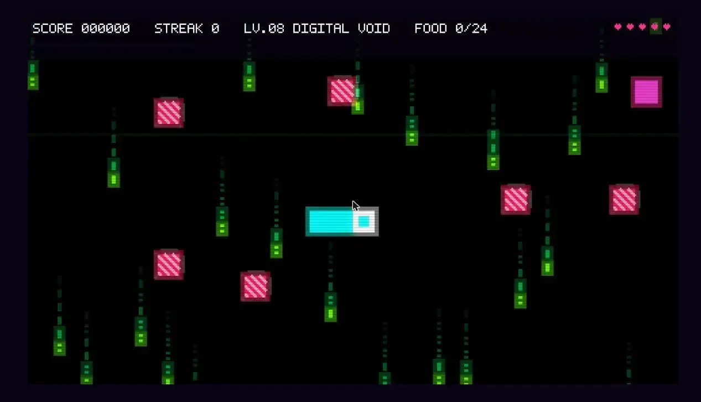
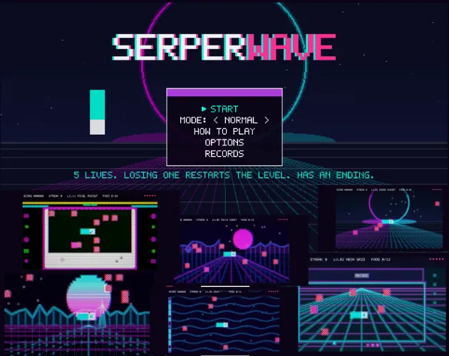
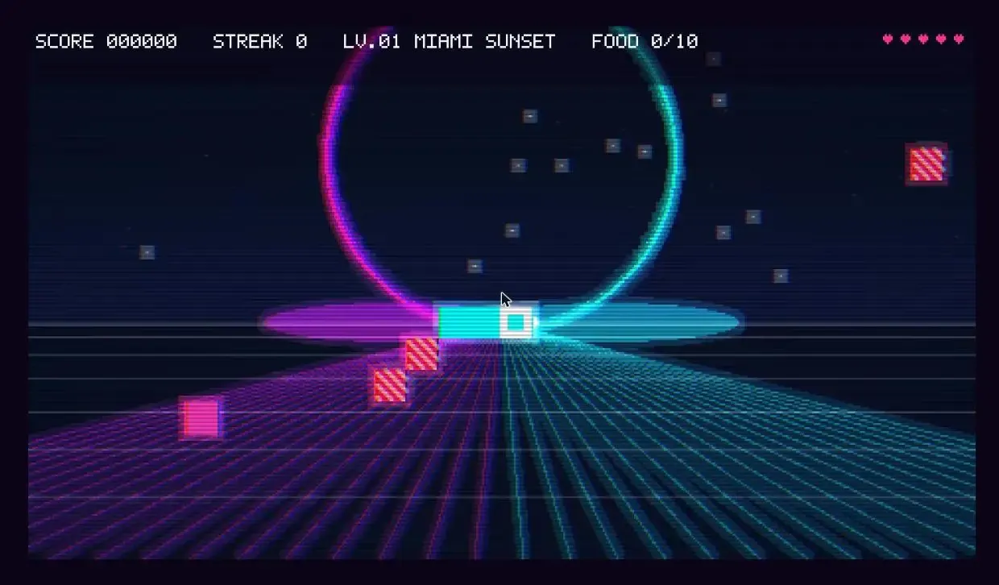
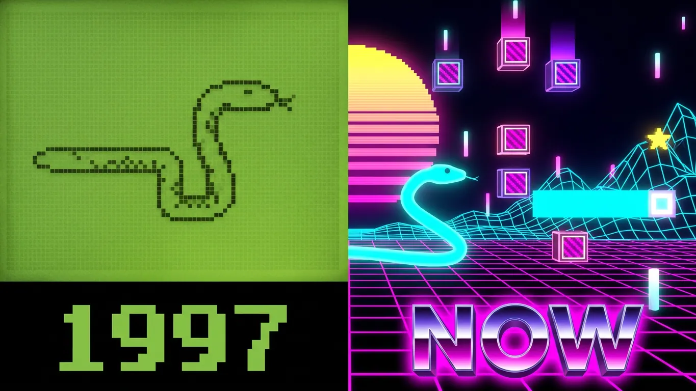
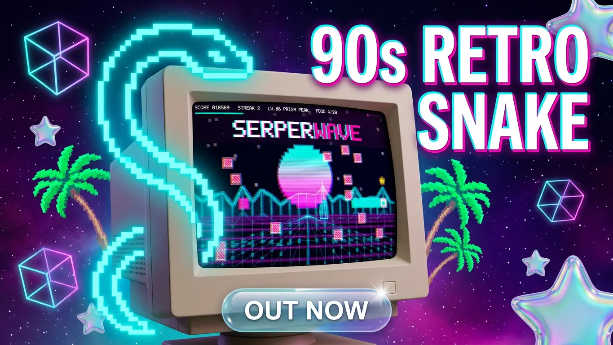

Snake was supposed to be a weekend project. The whole plan fit on a sticky note: food, a longer snake, walls, done.

What I shipped instead is **SERPERWAVE**, a free vaporwave snake game you play in the browser, dressed up as a 90s arcade cabinet. It has 13 levels, three game modes, a loot system with twenty possible outcomes and two soundtracks. Every time I finished one piece I could see the next one missing, and I added it. That's a habit of mine, not a plan.

- **Play it free in your browser:** [grecia-v.itch.io/serperwave](https://grecia-v.itch.io/serperwave)

<iframe style="width:100%;aspect-ratio:16/9;border:0;border-radius:12px" src="https://www.youtube-nocookie.com/embed/quV0Fv8Er4Y" title="SERPERWAVE: Free 90s Vaporwave Snake Game, Official Trailer" loading="lazy" allow="accelerometer; clipboard-write; encrypted-media; gyroscope; picture-in-picture" allowfullscreen></iframe>

---

## Why Phaser and not Godot

Choosing an engine took me longer than making some of the levels. Godot was the one I wanted, and I still plan to make something with it. But a small 2D arcade game that has to start the second you open a tab is web territory, and the web is what I know. So: **Phaser** with TypeScript.

There isn't a single sprite sheet, font file or audio file in the game. Every pixel is drawn in code, and both soundtracks come from a step sequencer that plays live in your browser.

Claude Code helped me write the code. The concept, the game design and the UI/UX design are mine.

## How it plays

The controls are the ones you remember: arrow keys, WASD, or swipe on a phone. Two things are new. If you hold the key for the direction you're already going, the snake speeds up until you let go. And the game remembers your next two turns, so a quick double turn into a tight corner does both moves in order instead of dropping one.

The rest of the game hangs on the **streak meter**. Food fills it, and it empties on its own the whole time. Keep it up and the mystery boxes start paying out RARE and EPIC items. Let it run dry and you'll mostly pull junk. The sound follows it too: each point raises the eating sound by a semitone, so you can hear a good run building before you look at the score.

## The loot: 20 mystery box outcomes

Boxes come in four rarities:

- **EPIC:** GHOST.EXE lets you pass through blocks. DATA HARVEST turns every lethal block on the board into food.
- **RARE:** OVERCLOCK ×2, MAGNET, BLUE SCREEN, SLOW.SYS, COMBO LOCK.
- **COMMON:** DEFRAG, SHIELD, TELEPORT, SHUFFLE, or plain points.
- **BAD:** INVERT.DLL reverses your controls. TURBO ERROR, BLOCK RAIN, VHS TRACKING, BLOAT and TAX make up the rest of the bad luck.

No box can end your run by itself. A bad one can set you up to end it on your own, though.

Four more pickups live outside the boxes. Apples give back a whole heart, stars give back half, and flowers are pure score. The rare one is the rainbow **PRISM STAR**: grab it and you jump straight to the next level.

## 13 neon levels

MIAMI SUNSET · NEON GRID · TERMINAL · AQUA / 水 · TOKYO NIGHT · MAGIC HOUR · OUTRUN · DIGITAL VOID · VAPOR TEMPLE · SYSTEM OVERLOAD · GAME BOY · GRID HORIZON · LIGHTFALL

Every level has its own colors, moving background and music, and I wanted them different enough that you'd know where you are from the sound alone. Some of them change the rules. On a few, the edges wrap around, so a wall becomes a way through. Two squeeze the whole board inside an object: an arcade cabinet in one, and in GAME BOY, a pink handheld screen. The area you can move in gets smaller as the difficulty goes up. Designing that was fun. Getting the collisions right inside a tiny screen was less fun.

If you want this look for your own project, I sell [synthwave and neon 3D models for Blender](/shop/3d-models/), tunnels and spheres included.

## Three modes, three different games

- **NORMAL:** five lives. A hit sends you back to the start of the level but keeps your score and progress. Beat level 13 and there's an ending waiting for you.
- **RUNNER:** no lives at all, one hit and it's over. This is the mode with the broken VHS shaders, where glitches and tracking noise eat the screen while you play. It has an ending of its own.
- **RANDOM:** endless, with the levels shuffled and three lives. No ending here, only your high score.

Clear enough levels and a level select unlocks, so you can go back to your favorite without replaying the whole run.

This walkthrough shows all 13 levels, if you'd rather see them before you play:

<iframe style="width:100%;aspect-ratio:16/9;border:0;border-radius:12px" src="https://www.youtube-nocookie.com/embed/LXP5P6Qlcwc" title="SERPERWAVE Gameplay Walkthrough, 13-Level Vaporwave Snake Game" loading="lazy" allow="accelerometer; clipboard-write; encrypted-media; gyroscope; picture-in-picture" allowfullscreen></iframe>

---

## Accessible by default, not as an afterthought

Two settings change how the game feels. Pause-on-pickup stops the action when you open a box and keeps the result on screen until you press a key. Turn it off if you'd rather not break your rhythm. The effects slider has three steps, 0, 50 and 100%, and at 0 there's no screen shake, glitch or static left.

If your system has `prefers-reduced-motion` turned on, the game follows it, and every level can be finished with the effects off. Lethal blocks carry three signals at once (color, diagonal stripes and a blinking border), so color isn't the only clue if you're colorblind. A keyboard alone or a touchscreen alone is enough to play. I care about this on websites too, and here's [how the accessibility menu on this site is built](/blog/posts/website-accessibility-menu-options/).

## Why it feels like a 90s arcade

A lot of us met snake on an old Nokia or a school computer. SERPERWAVE is that memory the way your head stored it, which is brighter than the real thing: neon sunsets, synthwave grids, CRT glow and scanlines.

The music does half of that work. From the main menu you can switch between two soundtracks: the full synthwave one, and a calmer one for when OUTRUN's beat starts to feel like too much.

The pixel art stays sharp because the game only scales in whole-number steps, whatever the size of your window or screen.

---

## Play SERPERWAVE

- **itch.io (free, in your browser):** [grecia-v.itch.io/serperwave](https://grecia-v.itch.io/serperwave)
- **YouTube:** [official trailer](https://www.youtube.com/watch?v=quV0Fv8Er4Y) and [full gameplay walkthrough](https://www.youtube.com/watch?v=LXP5P6Qlcwc)
- **Substack:** [Snake game, but it's a 90s arcade cabinet](https://greciart.substack.com/p/snake-game-but-its-a-90s-arcade-cabinet)

It lives in my [side projects](/side-projects/) next to *El Peso del Sí*, a short visual novel I made with Zim Yi, also in Phaser. More SERPERWAVE games set in the same universe are already in the works.

Go lose an evening to it. Then tell me which level killed you the most.
