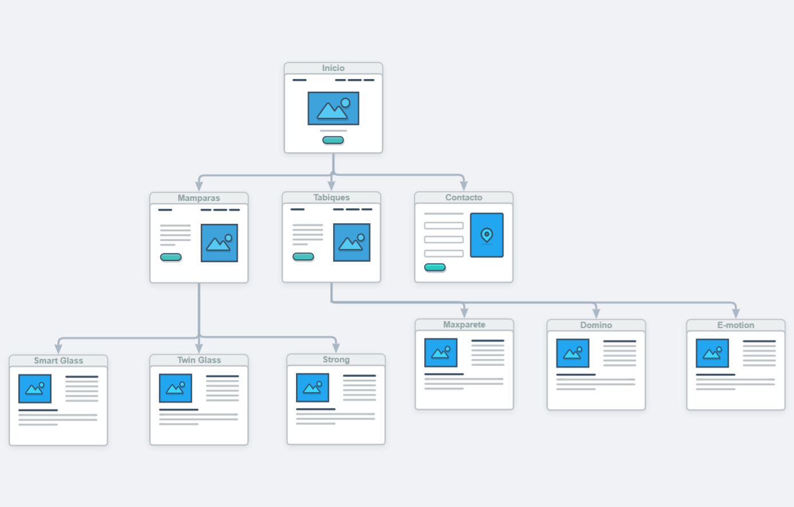
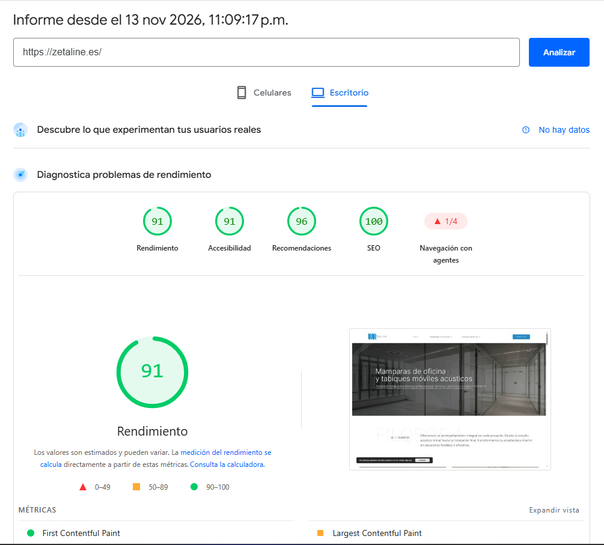

There's a kind of company that almost always has the same website. It makes something technical, installs it to measure and sells it to other businesses. Office partitions, enclosures, HVAC, machinery, office furniture. The site is a catalog of every product, an "about us" page and a contact form at the bottom.

And it almost always has the same problem: people visit, don't understand what they need and call to ask the basics. Or worse, they don't call.

I recently designed the website for [Zeta Line](/portfolio/projects/zetaline-office-partitions-wordpress-elementor/), a Madrid company that makes and installs office glass partitions and acoustic movable walls. This is what I'd apply to any technical product website.

---

## Your website doesn't sell. It guides.

Nobody buys a movable wall for a whole floor straight from a website. What actually happens is this: someone has a problem (an open office that's too loud, a hotel ballroom that needs dividing), searches on Google, visits three or four sites, compares them and forwards the one they trust most to their architect or their boss.

If your product is always quoted to measure, the site has one job: **get the right person to request a study or a quote**, with just enough information to feel confident doing it.

Anything that doesn't help with that is extra.

## Start with what the client knows, not what you make

Zeta Line has six systems: Smart Glass, Twin Glass, Strong, Maxparete, Domino and E-motion. For the team that makes them, the differences are obvious. For an office manager, they're six meaningless names.

The usual mistake is putting those six names in the menu and expecting the client to choose. That won't happen.

What I did was organize the site around the question the client can actually answer: **do you want a fixed division or one that moves?** Partitions or movable walls. Two options instead of six. Each one leads to its three systems, and each system has its own page.

If your catalog has a lot of products, find the first decision your client can make without help. That's your navigation.

## Offer a second door: the type of space

Some people don't even know whether they need something fixed or movable. But they do know what they have: a hotel, a school, an auditorium, an office.

That's why the site also has an applications section: offices, meeting rooms, hotels, schools, auditoriums, restaurants, events and training centers. It's another way into the same catalog, for people who think about their space and not about the product.

## Talk to two audiences, but separately

With a technical product there are almost always two people in the decision:

- **The person with the problem.** They need to know what each thing is for, how it'll look and whether it'll fix their noise or space issue.
- **The person who specifies it.** Architects, interior designers, engineers. They don't want to be sold to. They want spec sheets, finishes, construction details and installation manuals.

If you mix both on the same page, the first one gets lost in data and the second one gets bored by sales copy. On the Zeta Line site, product pages start with the use and leave the technical details lower down, and architects have their own documentation section.

## Answer the questions before they call

Ask your sales team what they get asked every week. Those answers go on the website.

In this case: the difference between the three partition types, how much noise they block, which finishes are available, whether the layout can change later and what kinds of spaces the movable walls go into. Every answered question is one less doubt before the quote request. And they're real Google searches too.

## Ask for one thing

A lot of B2B sites have five different calls to action: download the catalog, subscribe, follow us, contact us, book a demo. In the end, nobody does any of them.

If what you sell is always quoted to measure, the first real step is the study. So on the Zeta Line site there's a single action on every page, **"Request a study"**, with a phone call and WhatsApp as alternatives for people who'd rather talk.

## Don't let the photos slow the site down

Interior architecture products sell with photography. Finished spaces, glass, light. The problem is that a site full of large photos is a slow site, and a slow site loses people before they see anything.

The Zeta Line site scores **91 performance and 100 SEO** on PageSpeed Insights (desktop), and most of its content is photos. A score like that doesn't happen by accident:

- Optimize every image before uploading it. A photo straight from the camera can weigh more than the rest of the page combined.
- Write descriptive alt text. It helps accessibility and gets your project photos into Google Images.
- Set up Google Search Console and submit the sitemap, so Google finds every product page from day one.
- If you have a physical location, create your Google Business Profile. For a local company, that's often where the first contact comes from.

On mobile, a site like this always scores lower, and I'm not going to hide that: it's the next thing to improve.

## One page per product, one search per page

This is the most neglected part of SEO for industrial companies. If all your products live on a single catalog page, Google doesn't know which search to show it for.

Each system has its own URL, title and description, aimed at a specific search: "office partitions", "acoustic movable walls" or the system's own name, which people also search for. The category page groups the three and links to each. That way nobody lands on a generic page and has to search again.

## In short

If you have a technical product website and clients still call to ask the basics, the problem is almost never the design. It's the order you tell things in:

1. First, the decision the client knows how to make.
2. Then the product, explained by its use.
3. Technical data for whoever needs it, kept separate.
4. The usual questions, answered.
5. One action.

You can see how it all came together in the [Zeta Line case study](/portfolio/projects/zetaline-office-partitions-wordpress-elementor/). And if your site has this problem, [get in touch](/contact/) and we'll take a look.
