Quería pasar una medusa que modelé en Blender a pixel art. Busqué en YouTube y casi todos los tutoriales duran entre 20 minutos y una hora, arman el efecto nodo por nodo y la mitad del video es la intro. Al final resultó que hay nodos ya hechos que hacen todo en uno, y montarlos toma cinco minutos.

Este es el tutorial corto: cómo hacer **pixel art en Blender con nodos del compositor**, paso a paso y con capturas de cada nodo para que veas cómo queda la misma escena con cada efecto.

**Lo que necesitas:**

- **Blender 5.2** o más nuevo. Yo uso Blender 5.2.1 LTS.
- Una escena con cámara. La mía es una medusa con animación.
- Uno de estos dos recursos de nodos (o los dos):
  - El **nodo Dithering oficial de Blender**, que viene en la biblioteca de assets en línea.
  - **PixelAlchemy**, un paquete de nodos de Romasikkk que se descarga en [itch.io](https://romasikkk.itch.io/pixelalchemy).

No son el mismo nodo aunque los dos se llamen Dithering. Más abajo explico la diferencia.

---

## Paso 1: abre el compositor de Blender y actívalo en el viewport

Arriba, en las pestañas de espacios de trabajo, entra a **Compositing**.

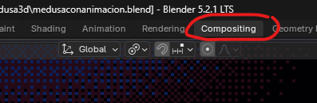

Luego, para ver el efecto en vivo en el viewport sin tener que renderizar cada vez, abre el menú de **Viewport Shading** (la flechita al lado de las esferas, arriba a la derecha del viewport). Al final del menú está **Compositor**. Cámbialo a **Always**.

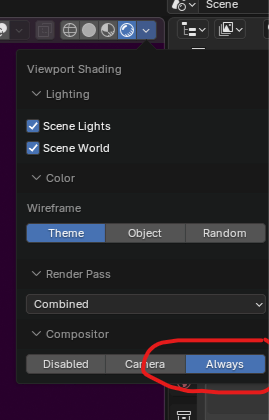

Con **Camera** solo lo ves cuando miras desde la cámara. Con **Always** lo ves siempre, aunque estés girando la escena, y así puedes ajustar los valores y ver el cambio al instante.

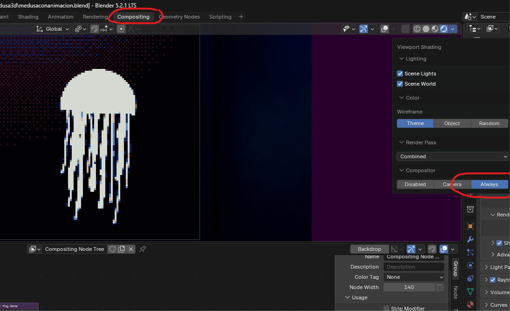

### El preview no siempre es igual al render

Lo más probable es que el render final no se vea exactamente como el preview del viewport. Valores como Pixel Size se miden en pixeles, y el viewport casi nunca tiene la misma resolución que tu render, así que los bloques pueden salir más grandes o más chicos, y el dithering más o menos marcado.

Mi recomendación: renderiza un frame con `F12`, compáralo con el preview y ajusta los valores hasta llegar al resultado que quieres. Toma un par de intentos.

## Paso 2: arma la cadena de nodos para el pixel art

En todas las capturas de este post uso la misma cadena:

**Render Layers → Fog Glow → nodo de efecto → Group Output y Viewer**

- **Render Layers** es tu render. Ya viene en el compositor.
- **Fog Glow** es el nodo **Glare** con el tipo en Fog Glow. Le da el brillo a la medusa antes de pixelarla. Es opcional, pero sin él el pixel art queda más plano.
- El **nodo de efecto** es el que convierte todo en pixel art. Lo cambias por el que quieras de los que vienen abajo.
- **Group Output** es la salida final del render, y **Viewer** te deja ver el resultado en el fondo del editor de nodos.

Para agregar cualquier nodo: con el ratón sobre el editor de nodos presiona `Shift + A` y busca el nombre.

## Opción A: el nodo Dithering oficial de Blender 5.2

### Cómo activar el Dithering en Blender

Este nodo no aparece hasta que le das permiso a Blender para conectarse a internet, porque viene de la biblioteca de assets en línea.

1. Ve a **Edit → Preferences → System**.
2. En **Network**, marca **Allow Online Access**.
3. Vuelve al compositor, presiona `Shift + A` y busca **Dithering**. Ahora sí aparece, junto con los otros assets de la biblioteca Essentials.

### Cómo se ve el Dithering de Blender

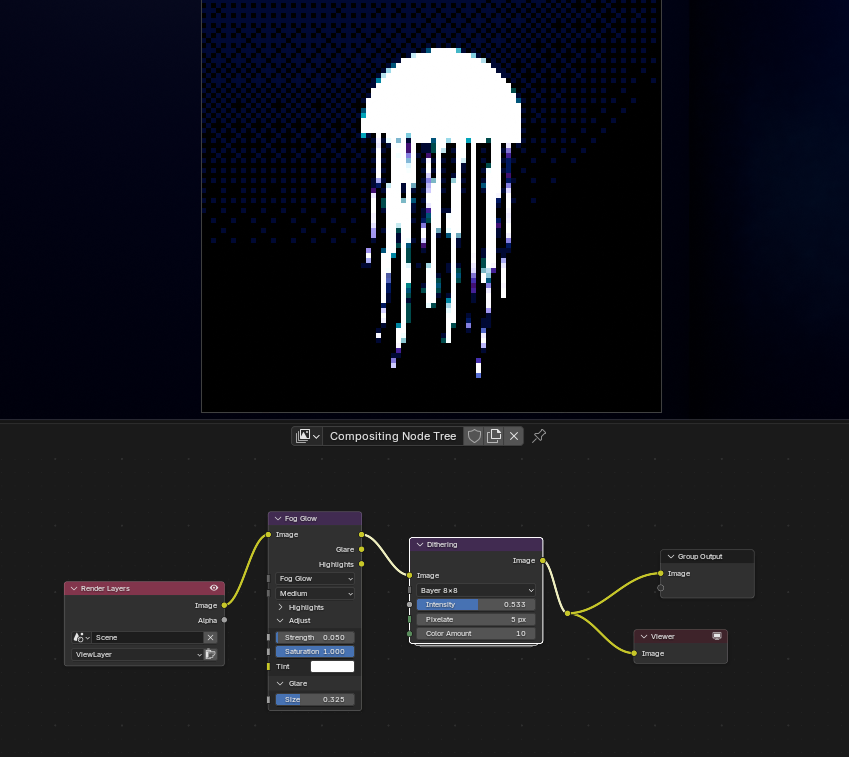

Tiene cuatro controles y nada más:

- **Tipo de patrón** (yo usé Bayer 8×8).
- **Intensity:** cuánto dithering se aplica.
- **Pixelate:** el tamaño del pixel. Con 5 px ya se ve claramente pixel art.
- **Color Amount:** cuántos colores quedan. Con 10 sale una paleta corta y con contraste.

Si solo quieres probar el efecto sin descargar nada, empieza por este.

## Opción B: los nodos de PixelAlchemy

[PixelAlchemy](https://romasikkk.itch.io/pixelalchemy) es un paquete de Romasikkk con siete grupos de nodos para el compositor, entre ellos Pixel Art, Dithering, ASCII y CRT. Tiene más controles que el nodo oficial: paletas, limpieza de ruido, contorno y varios tipos de patrón. Necesita Blender 5.2 o más nuevo.

### Cómo instalar PixelAlchemy

1. Descárgalo desde [romasikkk.itch.io/pixelalchemy](https://romasikkk.itch.io/pixelalchemy).
2. En tu proyecto ve a **File → Append**, abre el archivo `.blend` que descargaste, entra a la carpeta **NodeTree** y elige los nodos que quieras.
3. En el compositor, `Shift + A` → **Group** y ahí están.

### Nodo Pixel Art

El nodo principal. Los controles que más cambian el resultado:

- **Palette** y **Colors:** la paleta y cuántos colores usa (16, 32...).
- **Pixel Size:** el tamaño del pixel.
- **Dither:** cuánto patrón de puntos mezcla entre colores.
- **Clean:** cuánto limpia los pixeles sueltos.

Con Pixel Size en 4, Dither en 0.35 y Clean en 0, queda así:

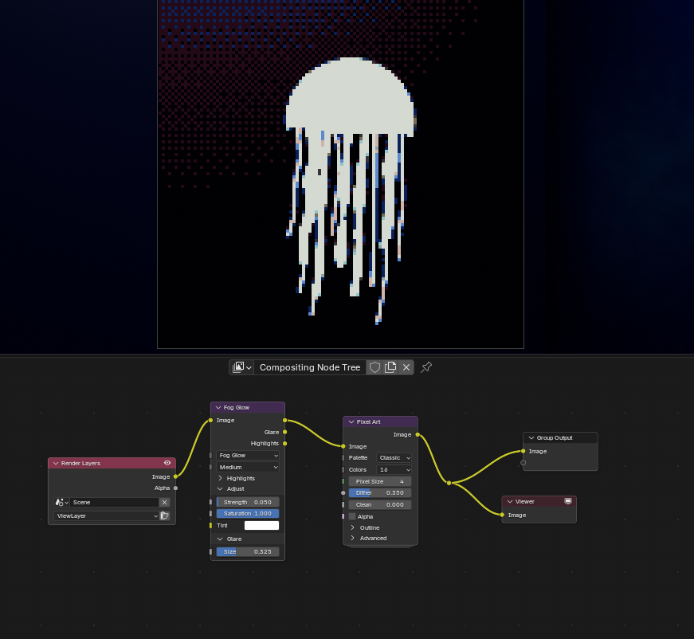

Subiendo Pixel Size a 5 y Clean a 0.475, los pixeles crecen y hay menos puntos sueltos en los tentáculos:

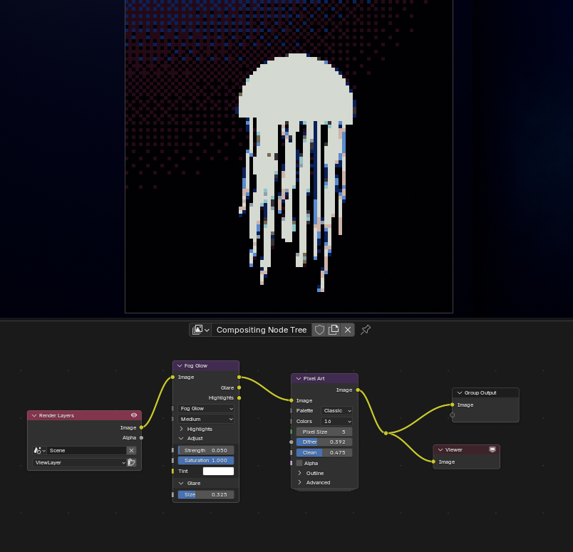

Y esta es mi favorita. Le subí la fuerza al Fog Glow (Strength 0.883, Size 0.825) y puse el Pixel Art en 32 colores con Dither 0.817 y Clean 0.933. El brillo alrededor de la medusa se convierte en un degradado de pixeles azules y rosados:

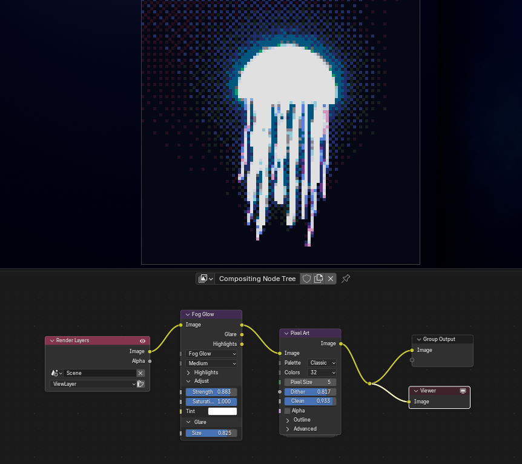

### Nodo Dithering de PixelAlchemy

El Dithering de PixelAlchemy tiene más opciones que el oficial: tipo de patrón, modo a color, niveles, contraste, brillo, saturación y una paleta propia. Con **Color** desactivado y **Levels** en 2 sale todo en blanco y negro, estilo pantalla de Game Boy o Mac antigua:

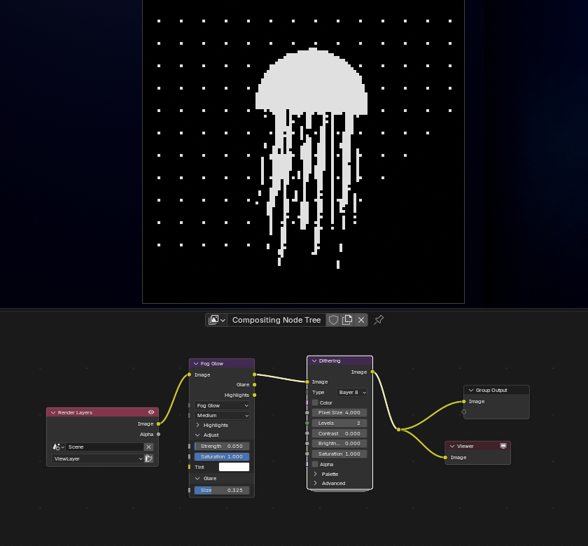

### Nodo ASCII

Convierte el render en caracteres de texto. **Tile Size** define el tamaño de cada carácter y **Levels** cuántos caracteres distintos usa según el brillo. Exposure y Gamma ayudan a que la figura se lea bien:

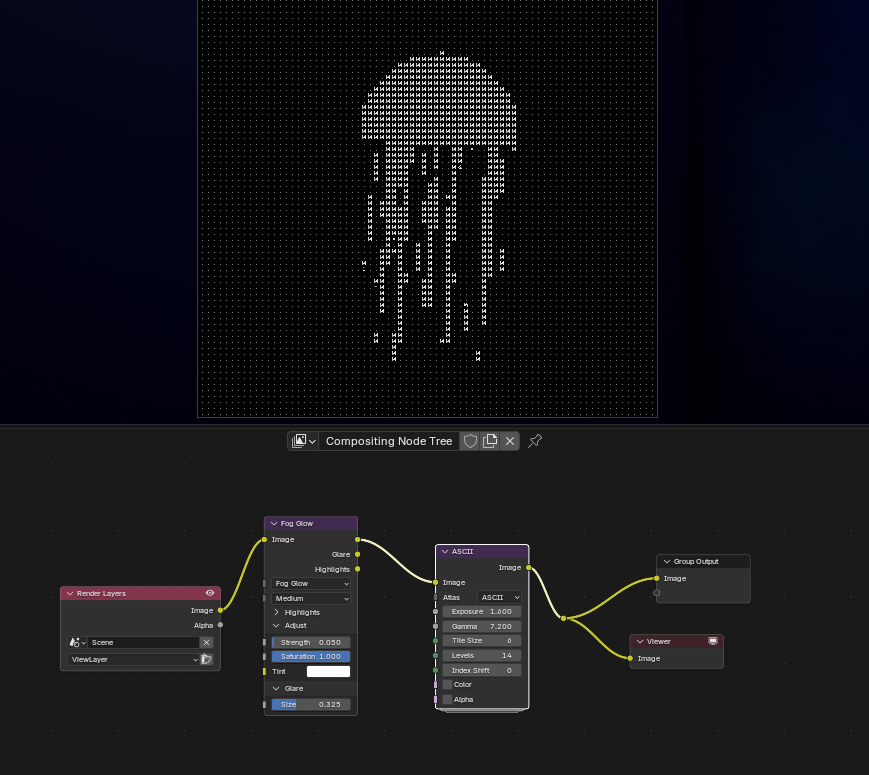

### Nodo CRT

No pixela tanto como los otros, pero simula un televisor viejo: líneas de escaneo, curvatura de pantalla, viñeta y bloom. Funciona bien encima de un render con mucho brillo:

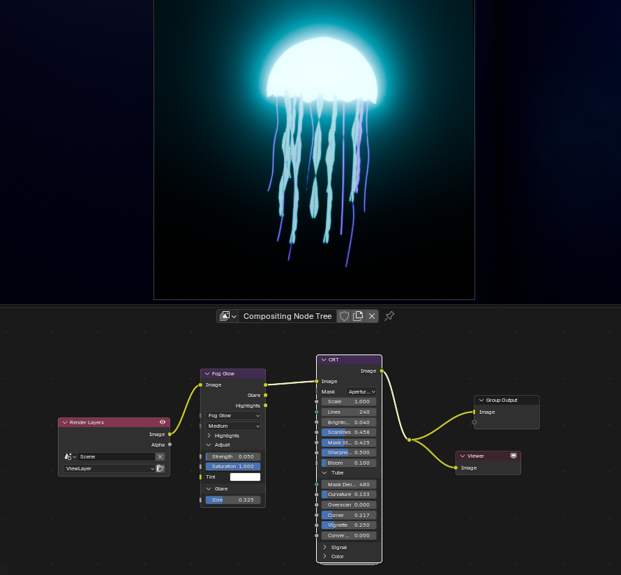

### Nodo Display

Imita la pantalla de un monitor LCD, con la rejilla de subpixeles visible. Con **Mask** en LCD y Pixel Size en 4, la medusa se ve como si estuviera en una pantalla vista de cerca:

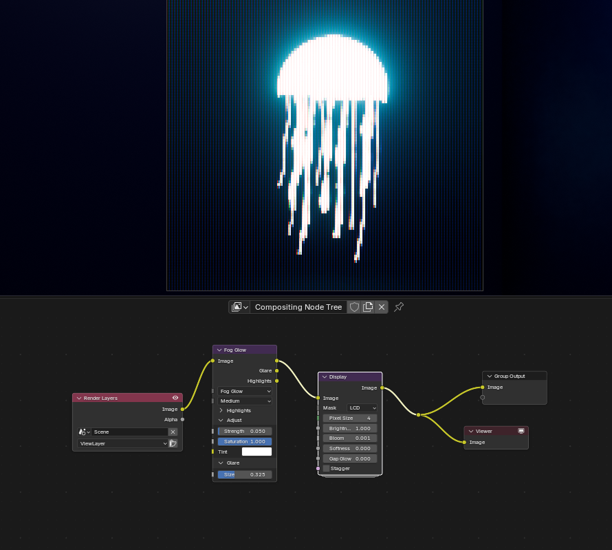

---

## ¿Qué nodo de pixel art usar en Blender?

| Nodo | Origen | Para qué lo usaría |
|---|---|---|
| Dithering | Blender (assets en línea) | Probar el efecto rápido, sin descargar nada |
| Pixel Art | PixelAlchemy | Pixel art a color con control de paleta |
| Dithering | PixelAlchemy | Blanco y negro o estilo retro con paleta propia |
| ASCII | PixelAlchemy | Arte con caracteres de texto |
| CRT | PixelAlchemy | Televisor viejo |
| Display | PixelAlchemy | Pantalla LCD |

Si nunca has hecho pixel art en Blender, empieza por el Dithering oficial para ver cómo funciona la cadena de nodos. Cuando quieras controlar la paleta o limpiar los bordes, pasa al Pixel Art de PixelAlchemy. Para la medusa me quedé con ese, con el Fog Glow subido.

## Preguntas frecuentes

### ¿Por qué no me aparece el nodo Dithering en Blender?

Porque viene de la biblioteca de assets en línea. Activa **Allow Online Access** en **Edit → Preferences → System → Network** y vuelve a buscarlo con `Shift + A` en el compositor.

### ¿Funciona con animaciones?

Sí. El compositor se aplica a cada frame que renderizas, así que si renderizas la animación completa, todos los frames salen en pixel art. Mi medusa está animada y uso la misma cadena de nodos.

### ¿Necesito instalar un add-on?

No. El Dithering oficial ya está en Blender cuando activas el acceso en línea, y PixelAlchemy son grupos de nodos que traes a tu archivo con **File → Append**, sin instalar nada en las preferencias.

Si quieres ver más cosas que hago en 3D, están en [extras](/es/extras/). Y si lo pruebas con tu propio modelo, me encantaría ver cómo te queda.
