Para estudiar y crear tenía las herramientas repartidas por todos lados: una web con anuncios para comprimir imágenes, otra para unir PDFs, una app de pago para planificar, y un sitio que subía mis archivos a quién sabe qué servidor para quitarles el fondo. Así que las junté en un solo lugar.

**BrainDeck** es una mesa de trabajo web con más de 20 herramientas para artistas, autodidactas y creativos. Funciona en el navegador, no pide cuenta y todo se procesa en tu dispositivo.

- **Pruébala:** [mybraindeck.netlify.app](https://mybraindeck.netlify.app/)
- **Código fuente:** [github.com/GVPV12/braindeck](https://github.com/GVPV12/braindeck)

---

## Qué es BrainDeck

Es una web estática: HTML, CSS y JavaScript, sin compilación, sin backend y sin cuentas. No hay servidor que guarde tus datos porque no hay servidor. Tus notas, planes y archivos se quedan en tu navegador.

Cada herramienta tiene su propio enlace, así que puedes compartir una sola. Se puede instalar como app desde Chrome o Edge, abre sin conexión después de la primera visita y está en español y en inglés.

## Un inicio que se juega como un RPG

El inicio es un dashboard con ventanas retro. Tienes un avatar, un nivel con XP, stats estilo RPG según qué herramientas usas, una racha en corazones y una bolsa de items en pixel art que se van desbloqueando con el uso.

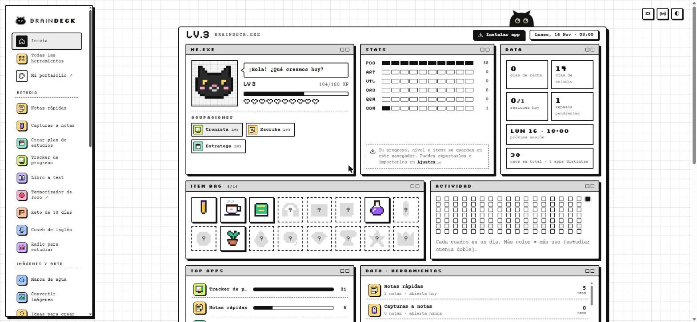

Más abajo están las apps que más usas, los datos de cada herramienta y todas las herramientas como íconos de un dispositivo, BrainDeck OS.

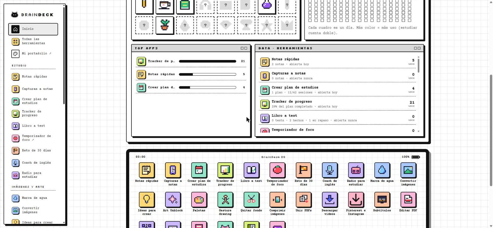

## Las herramientas

**Estudio:** notas rápidas, capturas a notas con OCR, crear plan de estudios, tracker de progreso, libro a test con repaso espaciado, reto de 30 días, coach de inglés hablado, radio para estudiar y acceso a [FOCUS TIME](/es/blog/posts/focus-time-gamified-adhd-productivity-app/).

**Imágenes y arte:** marca de agua, convertir y redimensionar, comprimir imágenes, quitar fondo, generador de paletas, ideas para crear, Art Unblock y gesture drawing.

**Utilidades:** unir PDFs, editar PDF, comandos para descargar videos, Pinterest e Instagram, subtítulos, generador de QR y buscador de atajos.

**Dinero:** calculadora de comisión y plan de ahorro.

## Un plan de estudios pensado para TDAH

Esta es la parte que más trabajo me llevó. El creador de planes convierte una lista de temas, libros o videos en un plan de estudio y evaluación, con calendario `.ics` para tu app de calendario. Tiene cuatro opciones que vienen desmarcadas, porque cada persona elige lo que le sirve:

- **Sin horas fijas:** cada sesión es para un día, no para una hora. Solo ves la duración, por ejemplo "≈45 min".
- **Un tema por día:** no mezcla libros o temas distintos el mismo día.
- **Día comodín:** el último día de estudio de la semana queda libre para ponerte al día.
- **Sin culpa:** lo pendiente "espera su turno" en vez de aparecer como atrasado.

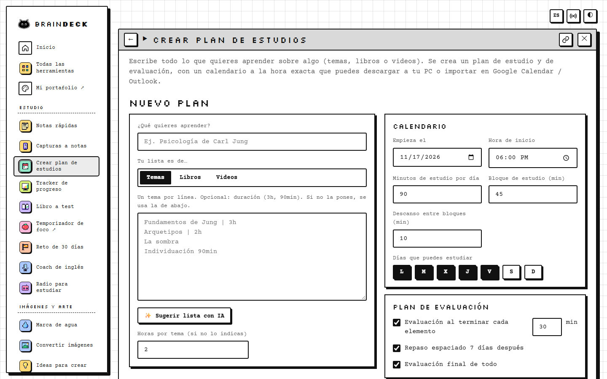

### El tracker: una sola cosa a la vez

Cuando abres el tracker, **ahora.exe** te pregunta cuánta energía tienes hoy (poca, normal o mucha) y te sugiere una sola tarea. Prefiere que sigas con lo mismo de la última vez, para que cueste menos arrancar.

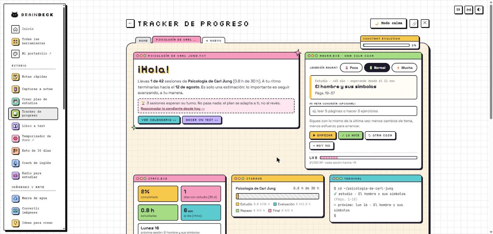

Puedes escribir una meta concreta para la sesión, y el cronómetro queda visible todo el tiempo, sin alarmas, porque la ceguera temporal es real. Si hoy no se puede, "Hoy no" la deja para después sin penalizarte. Si te atrasas, el mensaje es "2 sesiones esperan su turno. No pasa nada: el plan se adapta a ti, no al revés", con un botón para reacomodar lo pendiente desde hoy.

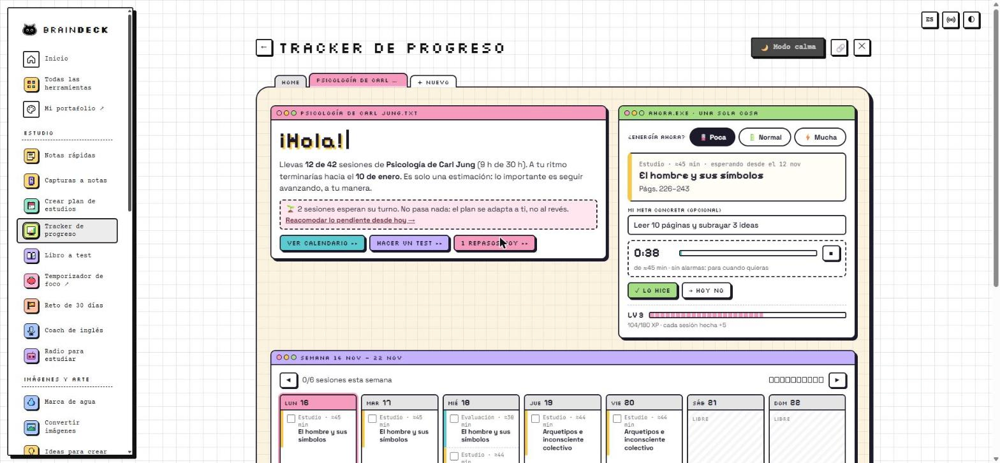

Debajo están las horas estudiadas, el porcentaje completado, tu ritmo diario y una terminal con lo que ya hiciste y lo que sigue.

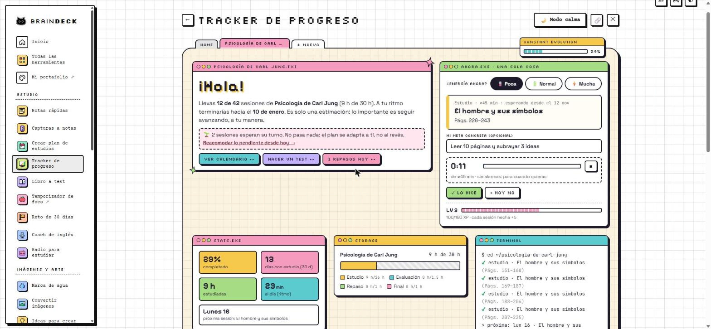

La semana muestra cada sesión en su día, y los días libres quedan marcados como libres.

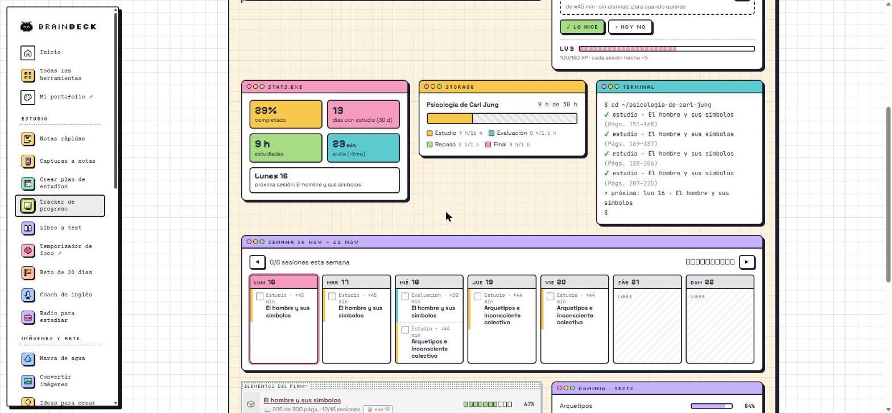

Los tests que haces en **Libro a test** alimentan la ventana de dominio, que muestra cuánto sabes de cada tema. Al lado quedan tus notas de estudio y un calendario de actividad.

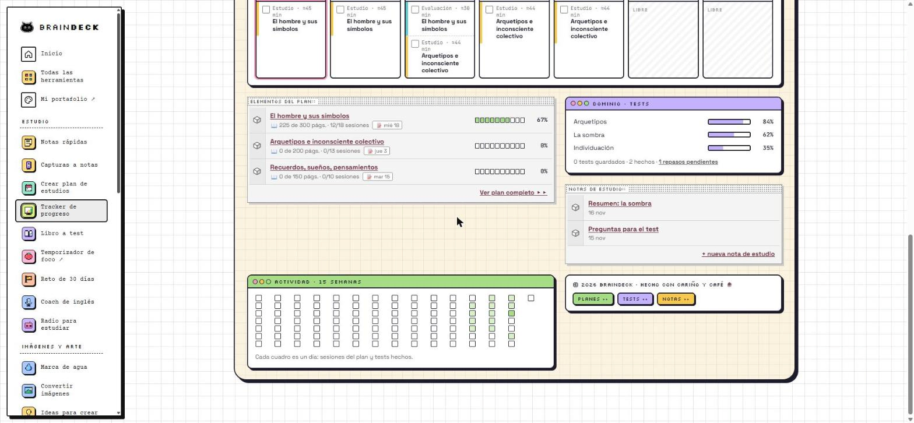

Y cuando terminas, lo celebra.

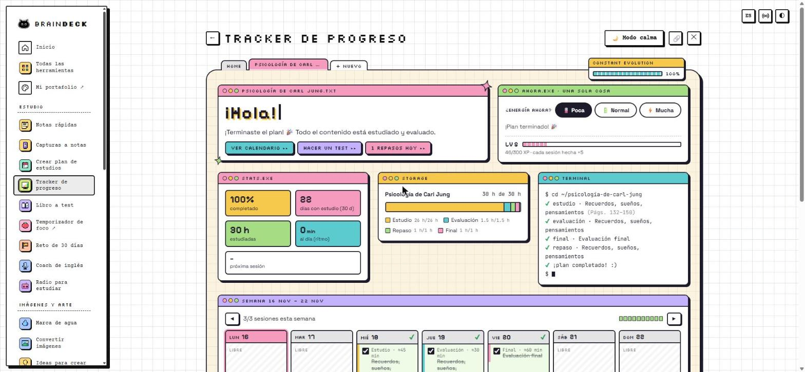

## Herramientas para artistas

Como ilustradora, estas son las que más uso:

- **Marca de agua:** marcas en lote con metadatos de autor (XMP, EXIF y PNG) y una señal de que no autorizas el entrenamiento de IA con tu arte. Si te interesa el tema, escribí sobre [cómo proteger tu arte del entrenamiento de IA](/es/blog/posts/protect-artwork-from-ai-training/).
- **Generador de paletas:** desde un color, una foto o una palabra, y exporta a Procreate, Adobe (`.ase`), GIMP, Krita, Blender y CSS.
- **Comprimir imágenes:** por calidad o a un peso exacto en KB, con comparador antes y después. También borra los metadatos ocultos, como la ubicación GPS.
- **Quitar fondo:** con IA que corre en tu navegador, sin subir la imagen a ningún lado.

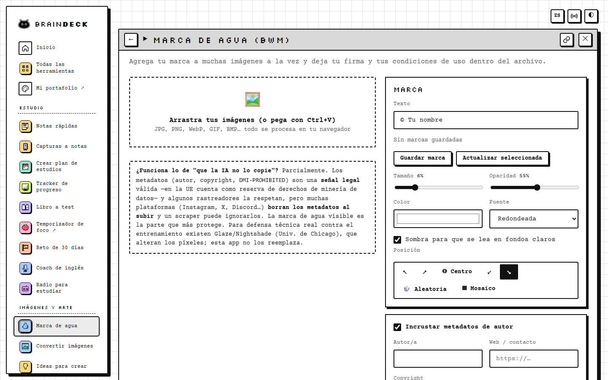

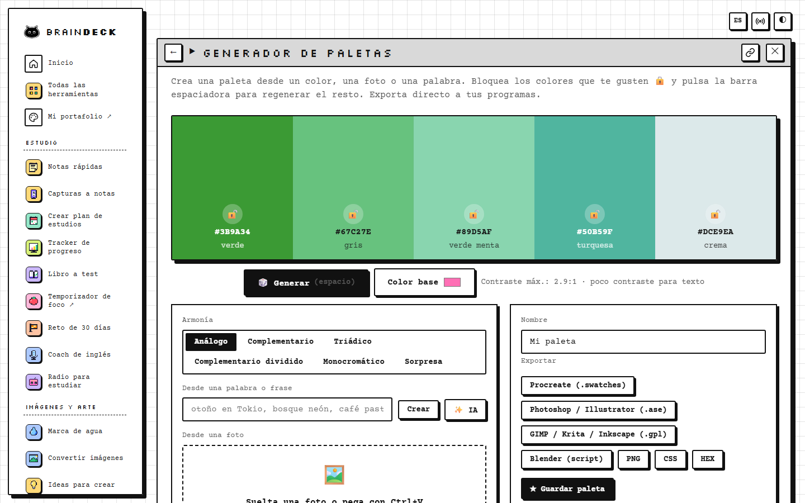

## Utilidades del día a día

**Editar PDF** reordena, gira, divide, numera y firma páginas. El **buscador de atajos** reúne los de Windows, macOS, Blender, Figma, Photoshop, Krita, Procreate y más, y se adapta a Ctrl o ⌘ según tu sistema.

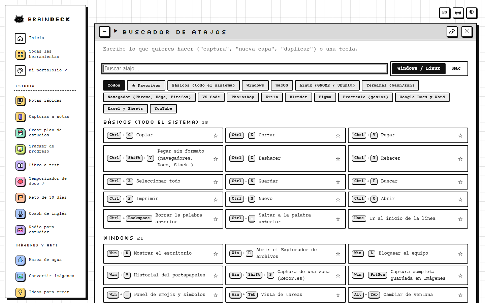

Para descargar videos, imágenes de Pinterest o reels de Instagram, BrainDeck no te manda a una web de descargas llena de anuncios. Te arma el comando exacto de [yt-dlp](https://github.com/yt-dlp/yt-dlp) o [gallery-dl](https://github.com/mikf/gallery-dl) para Windows, macOS o Linux, y lo copias con un botón. Es para descargar lo tuyo o lo que tengas permiso de usar.

## En el teléfono

En móvil el menú lateral pasa a una barra inferior, y lo probé a 360, 390 y 768 px de ancho sin que nada se desborde.

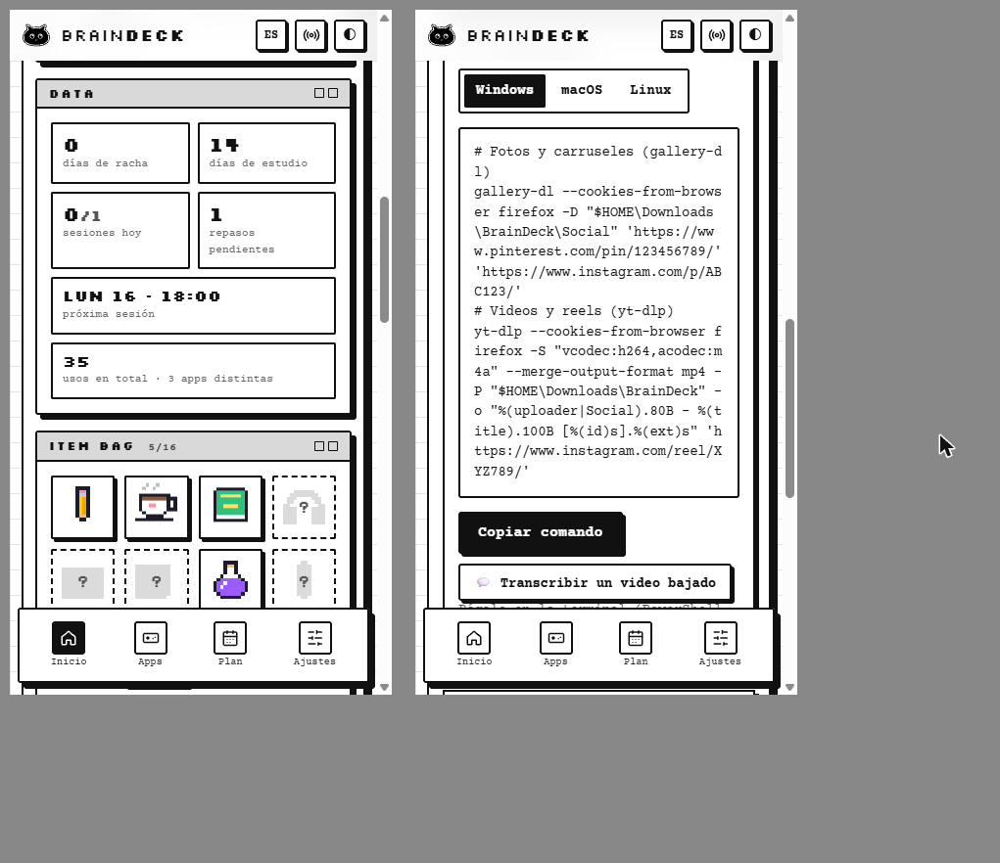

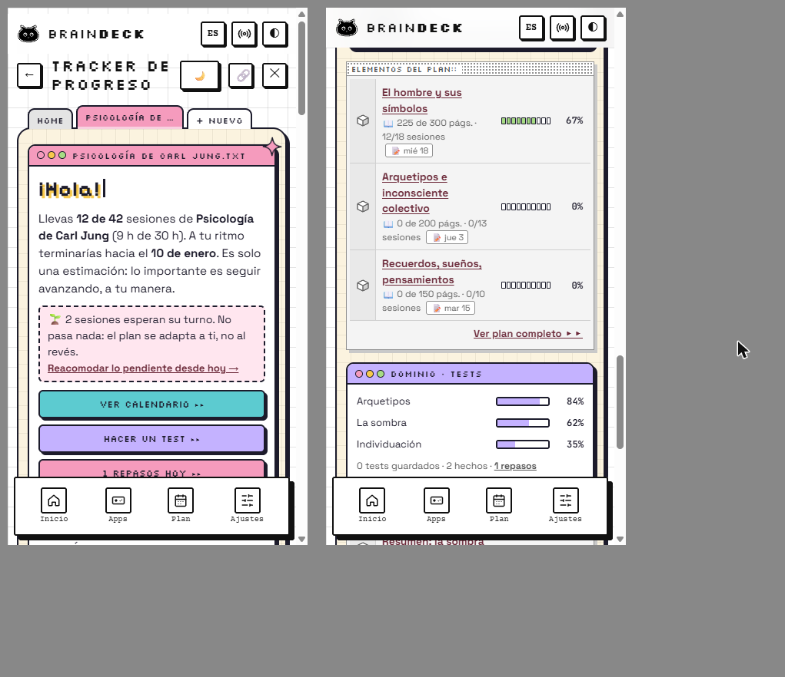

## Cuatro estilos visuales

Paper es el predeterminado, con papel cuadriculado y ventanas retro en blanco y negro. También están Neo pixel, que es neobrutalista, Cosmos, en glass oscuro, y Frost, más minimal. El que elijas se recuerda en cada visita.

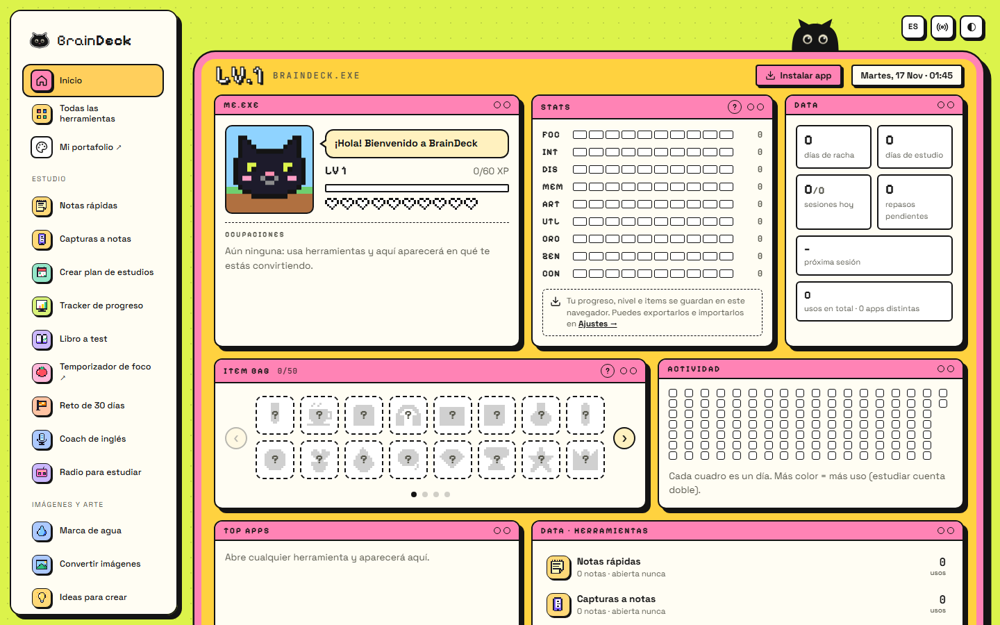

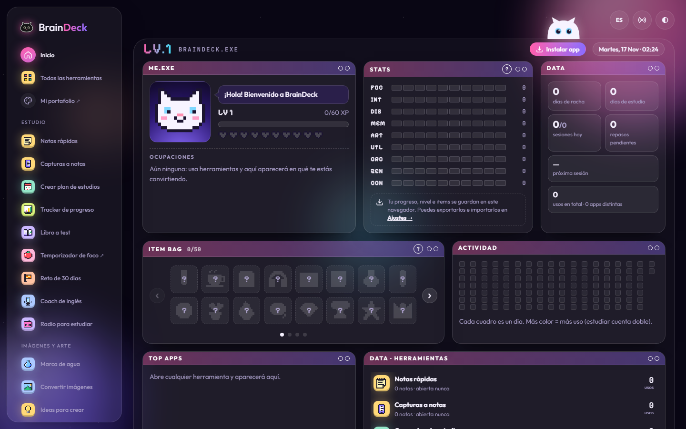

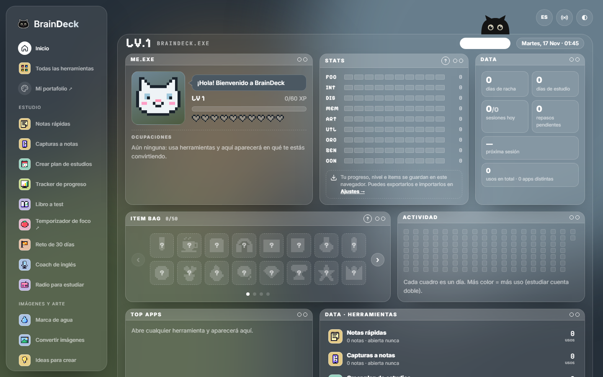

## Privacidad: tus datos no salen de tu navegador

- No hay servidor, analítica, cookies ni cuentas.
- Imágenes, PDFs, audios y notas se procesan en tu dispositivo.
- Puedes exportar una copia de tus datos **cifrada con contraseña** (AES-256-GCM) e importarla en otro navegador, combinándola con lo que ya tienes o reemplazándolo.
- Las fuentes se sirven desde BrainDeck y no desde Google, para que abrir la app no le mande tu IP a Google.
- Una política de seguridad (CSP) bloquea cualquier script que no sea de BrainDeck o de jsDelivr, y las librerías se verifican con su huella SHA-384 antes de guardarse.

La página de **Privacidad** dentro de la app explica qué se guarda, dónde, y qué servicios externos ven tu IP y cuándo, por ejemplo las emisoras de la radio.

## La IA es opcional

BrainDeck funciona sin IA. Si la quieres, hay dos niveles más:

- **IA local:** Whisper para transcribir, un modelo para quitar fondos y un modelo de lenguaje pequeño, todo corriendo en tu navegador con WebGPU (Chrome o Edge recientes).
- **Claude:** pones tu API key de Anthropic en Ajustes y solo se envía a `api.anthropic.com`. La key nunca se exporta, y puedes usarla solo durante la sesión para que no se guarde.

## Preguntas frecuentes

### ¿BrainDeck es gratis?

Sí. Es gratis y el código es abierto en [GitHub](https://github.com/GVPV12/braindeck).

### ¿Necesito crear una cuenta?

No. Abres la web y ya puedes usarla. Tu progreso se guarda en el navegador, y desde Ajustes puedes exportarlo e importarlo.

### ¿Funciona sin internet?

Después de la primera visita, sí. Las herramientas que dependen de internet, como la radio o la IA, necesitan conexión.

### ¿Sirve si tengo TDAH?

Lo diseñé pensando en el TDAH: tareas cortas, una sola cosa a la vez, el tiempo siempre visible, recompensas en vez de castigos y nada de culpa por atrasarte. Pero todas esas opciones las eliges tú, así que también sirve si no tienes TDAH.

Si la usas y algo te falta, cuéntamelo. BrainDeck empezó porque yo necesitaba estas herramientas, y la lista sigue creciendo.
