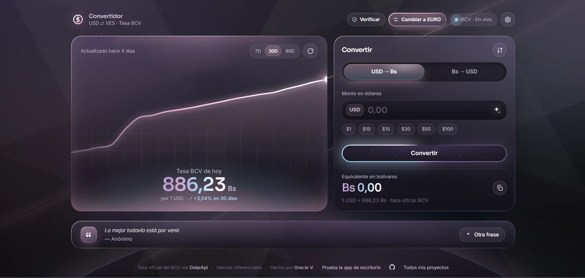
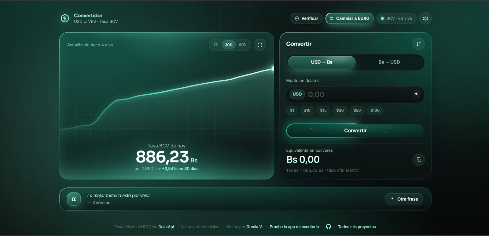
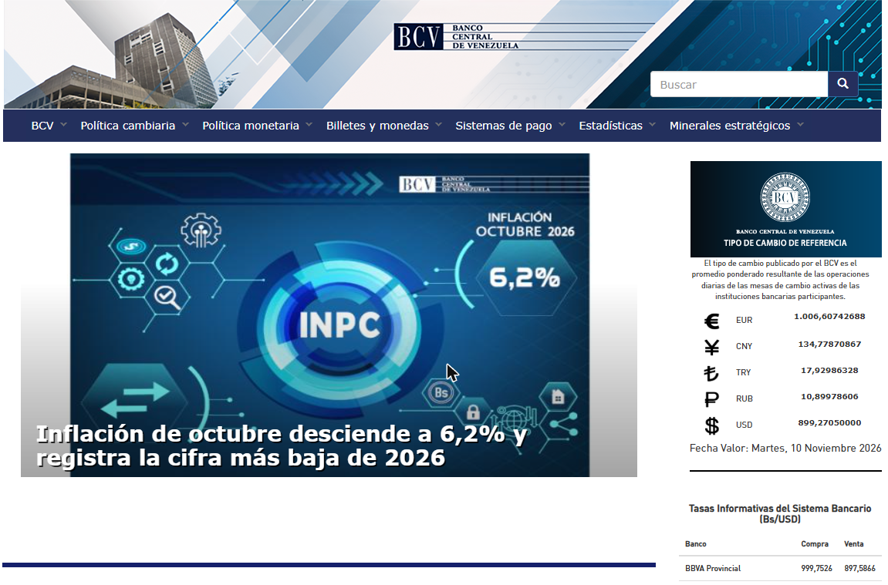
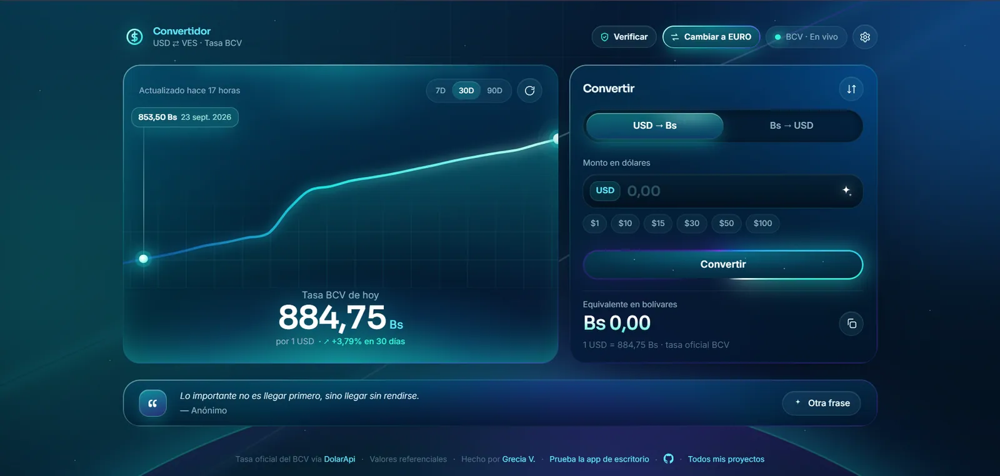

Si vives en Venezuela, o le mandas dinero a alguien que vive allá, convertir dólares a bolívares es algo que haces casi todos los días. Antes de pagar el mercado, antes de pasarle un precio a un cliente, antes de hacer un pago móvil. Y casi siempre con apuro, desde el teléfono, en una fila.

Para eso no deberías tener que instalar nada. Una conversión de dos segundos no justifica una app que ocupa espacio, pide permisos y te llena de notificaciones. El navegador que ya tienes alcanza.

Así que reuní las formas que de verdad sirven para convertir **dólares y euros a bolívares con la tasa BCV** desde el navegador, sin descargar nada, con lo bueno y lo malo de cada una.

---

## Por qué una app web y no una app instalada

Antes de la lista, lo que me hizo pasar mi propio convertidor de una app de escritorio a una web. Yo empecé con una [versión en Python](https://github.com/GVPV12/usdtoves) que había que instalar en la computadora, y me di cuenta rápido de que nadie, ni yo, la abría para un cálculo rápido en la calle.

Una app web tiene ventajas muy concretas:

- **No ocupa espacio.** En un teléfono con poca memoria, cada app instalada cuenta. Una página web no ocupa nada.
- **Siempre está actualizada.** No hay que esperar una actualización de la tienda ni aceptar nada. Si la tasa cambia o la app mejora, lo ves la próxima vez que la abres.
- **No pide permisos.** Ni contactos, ni ubicación, ni acceso a tus archivos. Una calculadora de moneda no necesita saber nada de ti.
- **Funciona en cualquier dispositivo.** Android, iPhone, la computadora del trabajo o la de un familiar. Mismo enlace, misma app.
- **Va mejor en teléfonos viejos.** Muchas apps de tasas cargan publicidad y librerías de rastreo que hacen lento un teléfono que ya va justo.
- **No depende de una tienda de apps.** No hay que buscarla, ni crear una cuenta, ni preocuparse de si la quitan de la tienda. Una web sigue en su dirección.

La única desventaja real es que necesitas conexión para ver la tasa nueva. Aun así, una app web bien hecha puede guardar la última tasa que cargó y mostrártela sin internet, que es lo que hace la mía.

## 1. Convertidor BCV

**Enlace:** [usdbcv.netlify.app](https://usdbcv.netlify.app/)

Esta la hice yo, así que obviamente es mi favorita, pero la hice justamente porque las demás no me terminaban de convencer. Al abrirla, lo primero que ves es la tasa BCV de hoy, en grande. Al lado está la calculadora, que convierte mientras escribes, de dólares o euros a bolívares y de bolívares de vuelta.

Lo que la hace distinta:

- **La tasa sale de la página del BCV.** Cada 30 minutos un script lee la tasa oficial directo de bcv.org.ve, así que la tasa nueva aparece apenas la publican, sin esperar a que una API de terceros se actualice.
- **Dólar y euro con un solo botón.** Toda la app cambia entre las dos monedas.
- **Montos rápidos** de 1, 10, 15, 30, 50 y 100, que son los que la mayoría consulta.
- **Gráfica de 7, 30 y 90 días** para ver si la tasa viene subiendo.
- **Botón para verificar** en la página oficial del BCV, por si quieres comparar el número.
- **Funciona sin conexión** con la última tasa cargada.
- **Se puede instalar como app** (PWA) desde el navegador, sin tienda de apps.
- **Sin publicidad**, gratis y con el [código abierto en GitHub](https://github.com/GVPV12/convertidor-bcv-web).

Y como también soy diseñadora, tiene tres skins de liquid glass para elegir. Es una herramienta, pero no tiene por qué verse triste.

### También se puede instalar como app (PWA), y es segura

El Convertidor BCV es una **PWA** (Progressive Web App): si quieres, el navegador te deja instalarla como una app más, con su ícono y su propia ventana, pero sin pasar por ninguna tienda y sin descargar un instalador. Y funciona sin conexión con la última tasa que cargó.

Antes de convertirla en PWA le hice una revisión de seguridad y privacidad al código, porque instalar algo en el teléfono tiene que dar confianza. Esto es lo que encontré y reforcé:

- **Vive dentro del navegador.** Una PWA no puede leer tus archivos, fotos ni contactos. Funciona con los mismos límites que cualquier página web, así que es más segura que un APK descargado de internet.
- **No pide ningún permiso.** La app tiene bloqueados a propósito la cámara, el micrófono, la ubicación y los pagos, así que no podría usarlos aunque quisiera.
- **No recoge datos.** No hay cookies, ni analíticas, ni rastreo, ni cuentas. Lo único que guarda en tu teléfono son tus preferencias (idioma, skin) y la última tasa.
- **Solo se conecta a donde tiene que conectarse.** Una política de seguridad le dice al navegador exactamente de dónde puede cargar cosas la app. Si alguien intentara meterle código o mandar datos a otro sitio, el navegador lo bloquea.
- **La tasa se verifica antes de publicarse.** La lectura del BCV se compara con una segunda fuente, y se descarta si no cuadra o si salta más de un 25 % de golpe. Un error en la página del BCV, o alguien intentando colar un número falso, no llega a tu pantalla.
- **Nunca te muestra una tasa vieja como si fuera nueva.** La tasa no se guarda en la caché de la app. Si no tienes conexión, lo dice con un punto rojo en lugar de verde.
- **El código es abierto.** Cualquiera puede revisar en [GitHub](https://github.com/GVPV12/convertidor-bcv-web) qué hace exactamente.

Si te interesa cómo está hecha por dentro, lo cuento en el [caso de estudio del Convertidor BCV](/es/portfolio/projects/bcv-dollar-bolivar-converter-web-app/).

## 2. La página oficial del BCV

**Enlace:** [bcv.org.ve](https://www.bcv.org.ve/)

Es la fuente. Todas las demás herramientas de esta lista, la mía incluida, sacan la tasa oficial de aquí, así que si tienes alguna duda sobre un número, esta es la página con la que comparas.

El problema es que no está pensada para convertir. Te muestra la tasa del día y tienes que hacer la multiplicación tú. Además no siempre carga rápido y en el teléfono se ve como una página de escritorio. Sirve para verificar, no para el día a día.

## 3. Hacé Cuentas

**Enlace:** [hacecuentas.com](https://hacecuentas.com/ve/finanzas/dolar-y-bolivares)

Tiene una calculadora de dólares a bolívares que además suma el **IVA (16%)** y el **IGTF (3%)**, algo muy útil si estás calculando el precio final de un producto o armando una factura. También tiene calculadoras de euros y de USDT.

La contra es que la tasa del BCV la escribes tú a mano, así que primero tienes que buscarla en otro lado. Es mejor para cuentas con impuestos que para una consulta rápida.

## 4. El buscador de Google

Escribir "1 USD a VES" en Google te da un convertidor al instante, sin entrar a ninguna página. Para tener una idea aproximada sirve.

Pero ojo: Google no dice de dónde saca ese número, y no siempre coincide con la tasa oficial del BCV. Para cobrar, pagar o cotizar en Venezuela, donde lo que importa es la tasa oficial del día, no lo usaría.

## 5. La calculadora del teléfono

El plan de siempre: buscar la tasa en la página del BCV y multiplicarla en la calculadora. Funciona, no necesita nada extra y es tan exacto como el número que copies.

Pero es tedioso. Son dos pasos cada vez: abrir la página del BCV, copiar la tasa, cambiar a la calculadora y multiplicar. Y si lo que necesitas es pasar de bolívares a dólares, toca dividir. Es fácil equivocarse con un decimal cuando estás apurada en una caja.

Con una app que ya trae la tasa del día y convierte mientras escribes, te ahorras todo eso. Igual, es decisión de cada quien: si prefieres la calculadora de siempre, también funciona.

---

## Comparación rápida

| Herramienta | Tasa oficial BCV | Convierte por ti | Dólar y euro | Sin conexión |
|---|---|---|---|---|
| Convertidor BCV | Sí, de bcv.org.ve | Sí, mientras escribes | Sí | Última tasa |
| Página del BCV | Sí, es la fuente | No | Sí | No |
| Hacé Cuentas | La escribes tú | Sí, con IVA e IGTF | Sí | No |
| Google | No garantizada | Sí | Sí | No |
| Calculadora del teléfono | La copias tú | No | Sí | Sí |

## Guárdala en tus marcadores y úsala como una app

El truco para que una app web se sienta como una app instalada es tenerla a un toque. Lo más práctico es guardarla en los marcadores del navegador que usas en el teléfono, o directamente en la pantalla de inicio.

**En Android, con Chrome:**

1. Abre [usdbcv.netlify.app](https://usdbcv.netlify.app/).
2. Toca el menú de los tres puntos, arriba a la derecha.
3. Toca la estrella para guardarla en marcadores, o **Instalar app** (en algunas versiones dice **Agregar a la pantalla principal**) para tener un ícono junto a tus apps.

**En iPhone, con Safari:**

1. Abre [usdbcv.netlify.app](https://usdbcv.netlify.app/).
2. Toca el botón de **Compartir**, el cuadrado con la flecha hacia arriba.
3. Elige **Agregar a marcadores**, o **Agregar a inicio** para tener un ícono en la pantalla principal.

**En la computadora:** presiona `Ctrl + D` (o `Cmd + D` en Mac) y queda en tus marcadores. En Chrome o Edge también puedes instalarla: aparece un ícono de instalar en la barra de direcciones, y la app se abre en su propia ventana.

Con el ícono en la pantalla de inicio la abres igual que cualquier otra app, pero sin instalar nada, sin ocupar memoria y siempre con la versión más nueva.

## ¿Cuál uso?

Para el día a día, el [Convertidor BCV](https://usdbcv.netlify.app/) guardado en la pantalla de inicio. Para cuentas con IVA e IGTF, Hacé Cuentas. Y si un número me parece raro, lo verifico en la página del BCV.

Lo que no haría es instalar una app para esto. Si una página web ya hace el trabajo, rápido, sin permisos y sin publicidad, no hay mucho que ganar descargando algo.

Y si ya usas otra herramienta que debería estar en esta lista, cuéntame cuál es.
