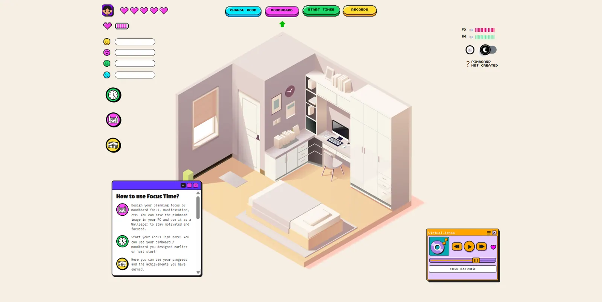

Cada post de este blog, este incluido, es un archivo `.md`. Sin CMS, sin editor con barra de herramientas. Abro VS Code, escribo, y Astro convierte el archivo en la página que estás leyendo.

La primera versión de este post era una chuleta genérica. Hasta incluía `==resaltado==` y los atajos de emoji tipo `:smile:`, y ninguno de los dos funciona en este sitio. Así que lo reescribí alrededor de lo que de verdad uso, lo que se rompe y lo que aprendí a los golpes.

## Cómo se ve un post antes de ser página

Cada post empieza con el frontmatter, el bloque entre las dos líneas `---`. Este es el de este mismo post, con la descripción y el texto alternativo recortados:

```markdown
---
layout: /src/layouts/MarkdownPostLayout.astro
title: "Guía de Markdown: la sintaxis que de verdad uso para escribir este blog"
author: Grecia V.
description: "Una guía práctica de Markdown de alguien que..."
image:
  url: "/images/posts/markdown.webp"
  alt: "Cuaderno con el logo de Markdown..."
pubDate: 2025-04-05
updatedDate: 2026-11-16
tags: ["SEO & Content", "Developer Tools", "Tutorials & Guides"]
languages: ["markdown", "astro", "html"]
---
```

El frontmatter es YAML, no Markdown, y trabaja más que el texto que va debajo. En este sitio:

- `title` y `description` se convierten en la etiqueta `<title>` y en la meta descripción que Google muestra en los resultados.
- `image` es la imagen de arriba del post y, después de que un script la recorta a 1200×630, la tarjeta de vista previa cuando alguien comparte el enlace.
- `pubDate` y `updatedDate` van a los datos estructurados del artículo y al sitemap, que es como Google se entera de que un post cambió.
- `tags` y `languages` arman las páginas de etiquetas y eligen los posts relacionados del final.

Si un campo está mal, la página igual se genera. Solo que se genera mal, y eso cuesta más notarlo que un error.

## Encabezados: empieza en ##, nunca en #

```markdown
## Una sección
### Una subsección
```

El layout ya imprime el título como el único `<h1>` de la página. Un `# Algo` dentro del post crearía un segundo, y entonces los lectores de pantalla y los buscadores reciben dos respuestas a "¿de qué trata esta página?".

La tabla de contenidos del costado lee cada `##` y `###` y se arma sola, así que los encabezados también son navegación. Los escribo como los buscaría alguien que lee por encima: "Cómo usarlo en Neocities" en vez de "Uso".

## Negrita, cursiva y tachado

```markdown
*cursiva* o _cursiva_
**negrita**
***negrita y cursiva***
~~tachado~~
```

Uso la cursiva como cuando remarco una palabra en voz alta (*en alguna parte*, *cómo*) y la negrita para la frase de cada sección que alguien leyendo por encima no se debería perder. Cuando medio párrafo está en negrita, ya nada destaca.

## Listas

```markdown
- Un elemento
- Otro elemento
  - Anidado con dos espacios

1. Primer paso
2. Segundo paso
```

Números solo cuando el orden importa, como en los pasos de instalación. Todo lo demás lleva guion. Elige un solo símbolo de viñeta y mantenlo: si cambias de `-` a `*` a mitad de camino, CommonMark empieza una lista nueva y aparece un espacio que no pediste.

## Enlaces

```markdown
[cómo me pasé a pnpm](/es/blog/posts/use-pnpm/)
[documentación de Astro](https://docs.astro.build/es/)
```

Los enlaces internos llevan la barra final. Este sitio sirve cada página en una sola dirección que termina en `/`, así que un enlace sin ella cuesta una redirección, y Search Console las archiva como "Página con redirección". El texto del enlace tiene que decir adónde lleva. "Haz clic aquí" no le dice nada ni a quien lee ni a Google.

## Imágenes: dos carpetas, dos comportamientos

```markdown


```

La primera ruta apunta a `public/`, y el archivo se sirve tal cual lo subí. La segunda pasa por el procesador de imágenes de Astro, que la comprime y escribe su ancho y alto en el HTML para que la página no salte mientras carga. Uso `assets` para las capturas dentro del post y `public/` para la portada, porque la portada necesita una URL fija para el script de las tarjetas sociales.

Las rutas relativas parten del archivo `.md`. Los posts en español viven una carpeta más adentro (`src/pages/es/blog/posts/`), así que acá la misma imagen es `../../../../assets/blog/...`, con un `../` más que en inglés. Si copias un post a la carpeta en español sin agregarlo, el build se detiene porque no encuentra la imagen.

En el texto alternativo describo lo que hay en la imagen. La portada de este mismo post tuvo durante meses el texto alternativo de mi post de bordes animados con Tailwind, y ese tipo de cosas solo las encuentras cuando sales a buscarlas.

## Código

El código en línea va entre comillas invertidas simples: `pnpm build`.

Los bloques llevan tres comillas invertidas y el nombre del lenguaje:

````markdown
```bash
pnpm build
```
````

El nombre del lenguaje es lo que activa el resaltado de sintaxis (este sitio usa Shiki con el tema `github-dark`). Si no lo pones, sale texto gris plano. Además, cada bloque de este blog tiene un botón de copiar que agrega un script pequeño del layout, así que pongo los comandos en su propio bloque en vez de esconderlos dentro de una frase.

Para mostrar Markdown dentro de Markdown, como los ejemplos de este post, envuelve el bloque en cuatro comillas invertidas para que las tres de adentro no lo cierren.

## Citas y líneas horizontales

```markdown
> Una cita, o una advertencia que tiene que separarse del texto.

---
```

Dentro del cuerpo, `---` dibuja una línea. Como primera línea del archivo, en cambio, abre el frontmatter.

## Tablas, listas de tareas y notas al pie

Vienen de GitHub Flavored Markdown (GFM), y Astro lo soporta sin configurar nada:

```markdown
| Gestor de paquetes | Lockfile |
| --- | --- |
| npm | package-lock.json |
| pnpm | pnpm-lock.yaml |

- [x] Escribir el post
- [ ] Traducirlo

Una afirmación que necesita fuente.[^1]

[^1]: La fuente.
```

Mantengo las tablas en dos o tres columnas para que sigan entrando en un celular.

## Lo que no funciona en un sitio con Astro

Muchas guías de Markdown incluyen sintaxis que solo entienden algunos editores. Con la configuración por defecto de Astro:

- `==resaltado==` imprime los signos de igual. Usa `<mark>resaltado</mark>`.
- `:smile:` imprime la palabra entre dos puntos. Pega el emoji directamente.
- `{#id-propio}` después de un encabezado aparece como texto. Astro ya le da a cada encabezado un id a partir de sus palabras.

Lo que sí funciona es el HTML normal. Markdown lo acepta, y así es como entran los videos de YouTube en mis posts: un `<iframe>` escrito directo en el archivo `.md`.

## Errores que me costaron más que una errata

**Etiquetas con espacios y "&".** Mis etiquetas son nombres como `SEO & Content`, y las páginas de etiquetas antes los usaban tal cual en la URL: `/blog/tags/SEO%20&%20Content/`. Google rastreó todas las variantes (codificada, en minúsculas, con espacios) y las reportó como duplicadas entre sí. Ahora el nombre sigue legible en el frontmatter y la URL sale de una función que genera el slug, `/blog/tags/seo-content/`. Las direcciones viejas necesitaron una página entera de redirecciones.

**Mismo nombre de archivo en dos idiomas.** La versión en inglés y la versión en español de cada post comparten nombre de archivo. Eso es lo que permite que el sitio las conecte como traducciones (hreflang) sin una tabla aparte. Si renombras una, dejan de ser pareja. El resto de esa configuración está en [cómo hice un sitio bilingüe con Astro](/es/blog/posts/bilingual-website-astro-i18n/).

**Reescribir un post sin cambiar la fecha.** Si reescribo algo y dejo la fecha igual, nada le avisa a Google que cambió. Para eso está `updatedDate`, y por eso este post lo tiene.

## Las herramientas que uso

- [VS Code](https://code.visualstudio.com/) y su vista previa integrada (`Ctrl+Shift+V`).
- La [especificación de CommonMark](https://spec.commonmark.org/), cuando necesito saber si algo es Markdown estándar o un extra de algún editor.
- La [especificación de GFM](https://github.github.com/gfm/), para tablas, listas de tareas y tachado.
- La [documentación de Markdown de Astro](https://docs.astro.build/es/guides/markdown-content/), para frontmatter, layouts e imágenes.

Si vas a empezar tu propio blog en Markdown, arma primero el frontmatter. Es lo que decide cómo aparece el post en Google y en redes, y cómo se conecta con el resto del sitio.
