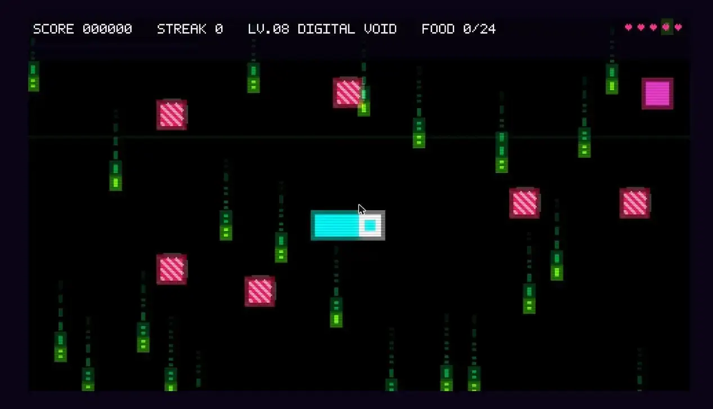
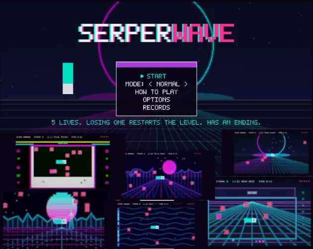
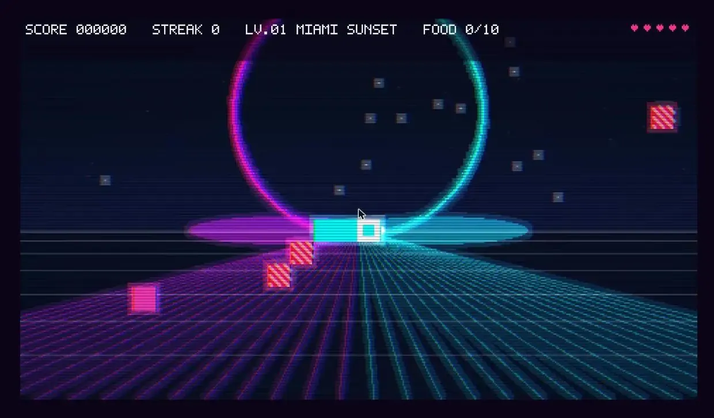
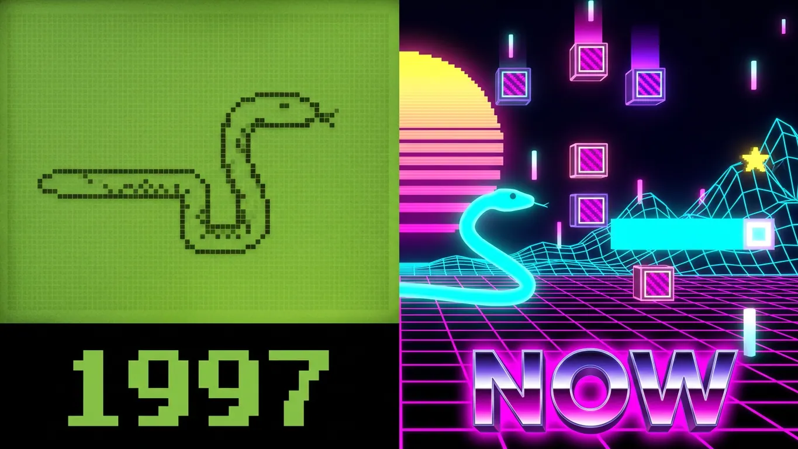
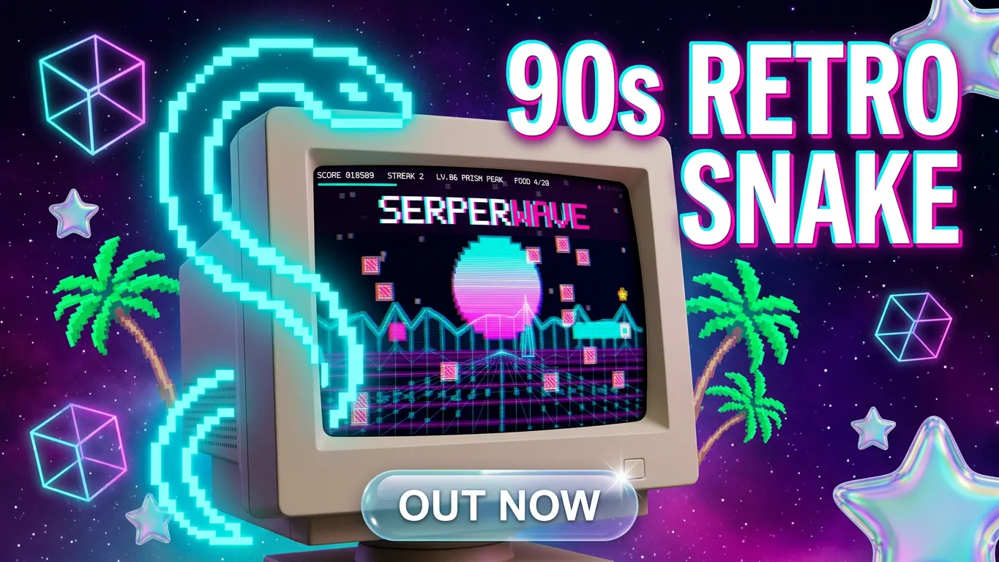

Dije que iba a hacer un juego de la viborita. Ese era todo el plan. Comer, crecer, no chocar con la pared y publicarlo en un fin de semana.

Trece niveles después tengo un sistema de combos con un medidor que se vacía, veinte resultados de cajas misteriosas en cuatro rarezas, tres modos de juego, dos bandas sonoras intercambiables y un nivel llamado GAME BOY donde todo el tablero vive dentro de una pantallita de consola portátil. Nada de eso era el plan. Cada vez que terminaba una pieza veía lo siguiente que faltaba, y nunca en mi vida he sido capaz de dejar "lo siguiente" en paz.

Eso es **SERPERWAVE**: una versión nostálgica y vaporwave del juego de la viborita con el que crecimos, con estética de máquina arcade de los 90 y gratis para jugar en el navegador. El mismo juego sencillo de siempre, pero más bonito, más brillante y muchísimo más rosado.

- **Juégalo gratis:** [grecia-v.itch.io/serperwave](https://grecia-v.itch.io/serperwave)
- **Código fuente:** [github.com/GVPV12/serperwave](https://github.com/GVPV12/serperwave)

<iframe style="width:100%;aspect-ratio:16/9;border:0;border-radius:12px" src="https://www.youtube-nocookie.com/embed/quV0Fv8Er4Y" title="SERPERWAVE: juego de la viborita vaporwave de los 90, tráiler oficial" loading="lazy" allow="accelerometer; clipboard-write; encrypted-media; gyroscope; picture-in-picture" allowfullscreen></iframe>

---

## Por qué Phaser y no Godot

Le di demasiadas vueltas a qué motor usar para mi primer juego lo bastante bueno como para publicarlo. Quería usar Godot, y lo voy a usar en el futuro, pero creo que brilla más en otro tipo de juegos. O quizás simplemente prefiero quedarme con lo que conozco, y lo que conozco es el desarrollo web. Para un arcade 2D sencillo que tiene que abrirse al instante en una pestaña del navegador, **Phaser** con TypeScript era la opción obvia.

## Cómo se juega

En el fondo sigue siendo la viborita. Flechas o WASD, o deslizar el dedo en el celular. Lo diferente es que si mantienes la dirección en la que ya te mueves, la serpiente acelera, y al soltar vuelve a su velocidad normal. Además las teclas se guardan de a dos, así que puedes encadenar dos giros en una esquina cerrada y ambos se ejecutan en orden, en lugar de que el juego solo registre la última tecla.

Lo que de verdad mueve el juego es el **medidor de racha**. No es un contador, es un temporizador. Cada comida lo llena y se está vaciando todo el tiempo, así que una racha es algo que defiendes, no algo que se acumula solo. Si dejas que se vacíe, vuelves a sacar casi pura basura. Si la mantienes viva, las cajas misteriosas se inclinan fuerte hacia el botín RARE y EPIC. Hasta el sonido de comer sube un semitono con cada punto, así que una buena partida *suena* como una buena partida antes de mirar el puntaje.

## El botín: 20 resultados de cajas misteriosas

Cuatro rarezas, veinte objetos:

- **EPIC:** GHOST.EXE te hace inmune a los bloques. DATA HARVEST convierte todos los bloques letales del tablero en comida.
- **RARE:** OVERCLOCK ×2, MAGNET, BLUE SCREEN, SLOW.SYS, COMBO LOCK.
- **COMMON:** DEFRAG, SHIELD, TELEPORT, SHUFFLE, puntos fijos.
- **BAD:** INVERT.DLL invierte tus controles, y además TURBO ERROR, BLOCK RAIN, VHS TRACKING, BLOAT y TAX.

Una caja nunca te mata directamente, aunque una mala tirada te pasa la pala con mucho gusto.

Fuera de las cajas hay cuatro objetos más. Las manzanas te devuelven un corazón entero, las estrellas medio, y las flores van directo al puntaje. Y si alguna vez aparece una **PRISM STAR** arcoíris, que es rarísimo, agárrala: te salta directo al siguiente nivel.

## 13 niveles neón (sí, es la cifra final)

MIAMI SUNSET · NEON GRID · TERMINAL · AQUA / 水 · TOKYO NIGHT · MAGIC HOUR · OUTRUN · DIGITAL VOID · VAPOR TEMPLE · SYSTEM OVERLOAD · GAME BOY · GRID HORIZON · LIGHTFALL

Cada uno tiene su propia paleta, su fondo animado y su banda sonora. Deberías poder saber en qué nivel estás con los ojos cerrados. Algunos además rompen las reglas: bordes que te teletransportan al otro lado y convierten las paredes en puertas, y un par que encierran el tablero dentro de otra cosa, como una máquina arcade vieja o esa consola portátil. El espacio para moverte se achica a medida que el juego se pone difícil, lo cual fue un problema divertido de diseñar y un poquito menos divertido de programar.

Por cierto, si te gusta esta estética, también vendo [modelos 3D synthwave y neón para Blender](/es/shop/3d-models/), con túneles y esferas incluidos, por si quieres un fondo así para tu propio proyecto.

## Tres modos, tres juegos distintos

- **NORMAL** es el modo por defecto. 5 vidas, y si te golpeas se reinicia el nivel conservando tu puntaje y tu progreso. Si pasas los 13 niveles tienes un final de verdad.
- **RUNNER** no tiene vidas. Un golpe y se acabó. También es el único modo donde aparecen los shaders de VHS roto, con glitch y distorsión de tracking degradando la pantalla mientras juegas. Tiene su propio final.
- **RANDOM** es infinito. Niveles en orden aleatorio, 3 vidas, sin línea de meta. Pensado para perseguir el récord.

Aquí tienes el recorrido completo, por si quieres ver los 13 niveles antes de jugar:

<iframe style="width:100%;aspect-ratio:16/9;border:0;border-radius:12px" src="https://www.youtube-nocookie.com/embed/LXP5P6Qlcwc" title="SERPERWAVE, gameplay completo de los 13 niveles del juego de la viborita vaporwave" loading="lazy" allow="accelerometer; clipboard-write; encrypted-media; gyroscope; picture-in-picture" allowfullscreen></iframe>

---

## Accesible desde el principio, no como parche

Hay una opción de pausa al recoger objetos: al abrir una caja el juego se congela y te muestra lo que te salió hasta que presiones una tecla, o puedes apagarla y mantener el ritmo. Y hay un **control de intensidad de efectos** en 0, 50 o 100% que baja el temblor de pantalla, el glitch y la estática hasta desaparecer.

Respeta `prefers-reduced-motion` y se puede jugar completo con todos los efectos en cero. Los bloques letales se marcan de tres formas a la vez, color, rayas diagonales y un borde que parpadea, para que se distingan aunque seas daltónico. Y se puede jugar solo con teclado o solo con pantalla táctil. (Esto también me importa en las webs: aquí cuento [cómo está construido el menú de accesibilidad de este sitio](/es/blog/posts/website-accessibility-menu-options/).)

## Por qué se siente como un arcade de los 90

La viborita fue de los primeros juegos que muchos jugamos, en un Nokia viejo o en la computadora del colegio. Quería que SERPERWAVE se sintiera como ese recuerdo, pero en la versión que tu cerebro recuerda y no en la real: atardeceres neón, cuadrículas synthwave, brillo de pantalla CRT y líneas de escaneo, un nivel escondido dentro de una máquina arcade y otro dentro de una consola portátil rosada.

La música importa tanto como los colores. Hay dos bandas sonoras retro completas para elegir desde el menú principal, una con toda la energía synthwave y otra más suave, por si prefieres no tener el tempo de OUTRUN viviendo en tu pecho toda la partida.

Y los píxeles se mantienen nítidos: el juego solo escala en números enteros, así que nunca se ve borroso, en ningún tamaño de ventana ni en ninguna pantalla.

---

## Juega SERPERWAVE

- **itch.io (gratis, en el navegador):** [grecia-v.itch.io/serperwave](https://grecia-v.itch.io/serperwave)
- **GitHub:** [github.com/GVPV12/serperwave](https://github.com/GVPV12/serperwave)
- **YouTube:** [tráiler oficial](https://www.youtube.com/watch?v=quV0Fv8Er4Y) y [gameplay completo](https://www.youtube.com/watch?v=LXP5P6Qlcwc)
- **Substack:** [la historia completa en mi Substack](https://greciart.substack.com/p/snake-game-but-its-a-90s-arcade-cabinet)

Es uno de los juegos de mis [proyectos personales](/es/side-projects/), junto a *El Peso del Sí*, una novela visual corta que hice con Zim Yi, también en Phaser. Y hay más juegos de SERPERWAVE en el taller, ambientados en el mismo universo.

Ve y piérdete una tarde jugándolo. Después cuéntame qué nivel te mató más veces.
