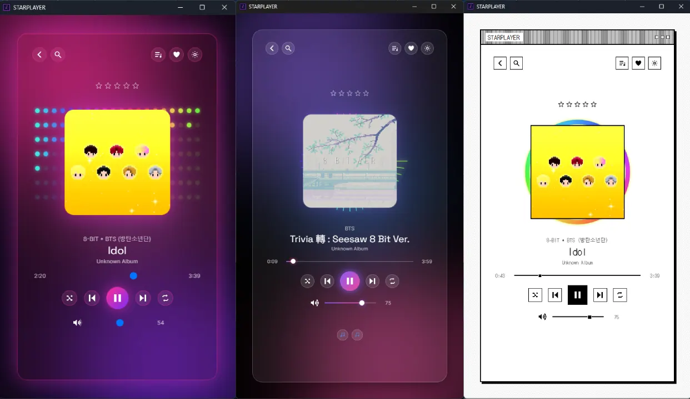
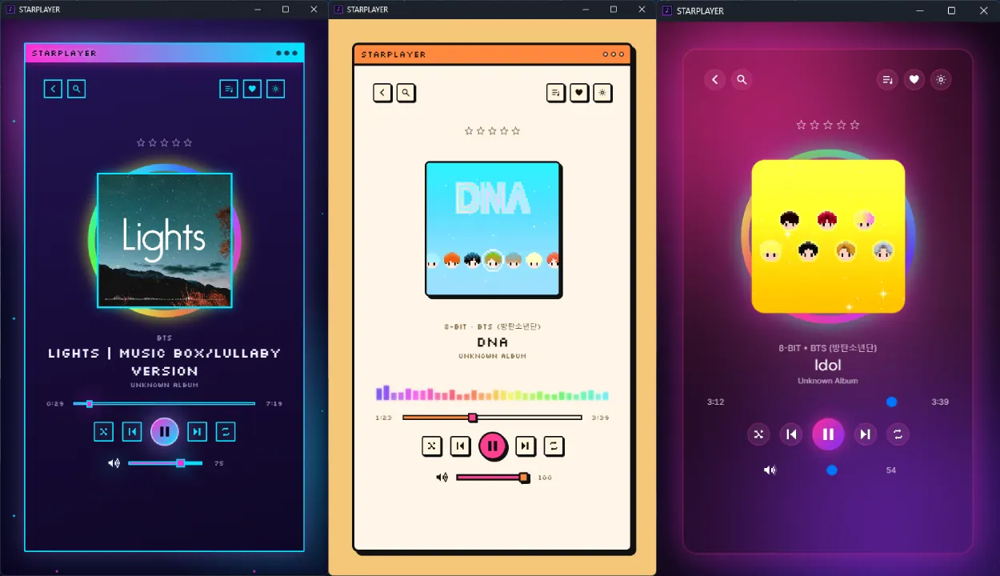
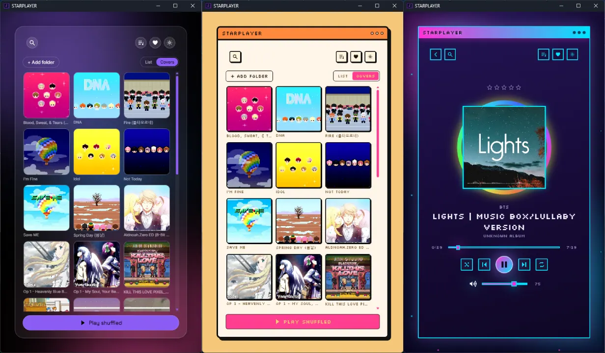
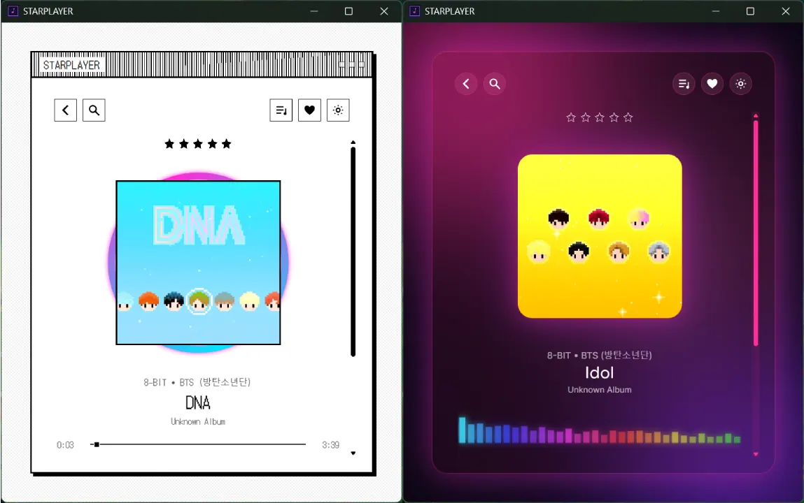

Me cansé. Me cansé de la publicidad (que ahora encima es hecha con IA), de las interfaces que no me gustan y de los reproductores de música que vienen instalados por defecto en los sistemas operativos.

Quería algo diferente: una aplicación para escuchar **mi música local**, con una interfaz que de verdad me gustara mirar y opciones para personalizarla a mi manera. Y por supuesto privada, sin que lo que escucho se le mande a ninguna empresa para usarlo vaya a saber para qué.

Así que creé **STARPLAYER**, mi propio reproductor de música para escritorio. Está inspirado en las interfaces retro, la estética vaporwave y los sistemas operativos de antes, pero con funciones modernas para organizar y escuchar música.

- **Código fuente:** [github.com/GVPV12/STARPLAYER](https://github.com/GVPV12/STARPLAYER)
- **Substack:** [la historia completa en mi Substack](https://greciart.substack.com/p/starplayer-reproductor-musica-sin-anuncios)

---

## ¿Para qué crear otro reproductor de música?

Existen muchísimas apps para escuchar música, así que hacer otra puede parecer innecesario. Pero quería resolver lo que me molestaba de las que usaba: no siempre me gustaba su diseño, no quería depender de una experiencia llena de publicidad y extrañaba tener control real sobre cómo se ve y se organiza mi biblioteca musical.

STARPLAYER parte de una idea sencilla: **un reproductor de música de escritorio debería dejarte escuchar tus canciones, organizar tu biblioteca y personalizar la interfaz, sin obligarte a aceptar un diseño que no te gusta.**

También quería que tuviera personalidad propia. En lugar de otro reproductor minimalista con interfaz genérica, experimenté con ventanas pixeladas, tipografías bitmap, colores neón y estilos visuales muy distintos. Y para quien prefiera algo más tranquilo, también hay estilos modernos minimalistas y glassmorphism.

## Un reproductor de música personalizable: vaporwave, retro, cristal y más

La parte que más me emociona es el **sistema de skins**. La apariencia no está limitada a un único tema: puedes cambiar toda la interfaz sin tocar el código de sus componentes.

Ahora mismo trae cinco skins:

- **Vaporwave:** colores neón y una estética de cultura digital retro.
- **Neo-Brutalist Cute:** elementos contundentes con un toque divertido.
- **Gradient Glass:** degradados y una apariencia de cristal translúcido.
- **Monochrome Retro:** una interfaz de un solo color que recuerda a los sistemas informáticos clásicos.
- **Soft Glass:** una versión más suave del cristal.

Hay tres formas de manejar las skins: elegirla a mano, que salga una al azar al abrir la app, o dejar que el reproductor **adapte la apariencia al ritmo o al estado de ánimo estimado de la canción**. Y hay un creador de skins personalizadas para cambiar colores, tipografías, bordes y fondos sin rehacer la interfaz.

Para mí, personalizar no debería quedarse en modo claro contra modo oscuro. Quiero que el reproductor se sienta como una pequeña extensión de tu escritorio y de tus gustos. (Si también te gustan las interfaces nostálgicas y de cristal en la web, esa es justamente la idea detrás de mis [plantillas web Frutiger Aero y Y2K](/es/shop/templates/).)

## Funciones de STARPLAYER

Además de lo visual, quería que fuera útil de verdad para manejar una biblioteca local:

- **Reproducción de música local** desde las canciones guardadas en tu computadora.
- **Biblioteca por carpetas:** eliges una carpeta y encuentra tus canciones, subcarpetas incluidas.
- **Formatos de audio habituales:** MP3, FLAC, WAV, M4A y OGG.
- **Playlists** para agrupar canciones como quieras.
- **Calificación con estrellas** para ordenar tu música según lo que de verdad te gusta.
- **Reproducción según el estado de ánimo**, a partir de cómo se clasifican las canciones.
- **Aleatorio y repetición.**
- **Skins intercambiables**, **creador de temas personalizados** y **skin aleatoria** al iniciar.
- **Visuales que siguen el ritmo**, ligados al BPM estimado y al ánimo de cada canción.
- **Biblioteca en SQLite** guardada en local, y **metadatos** leídos de las etiquetas de tus archivos.

La idea es que STARPLAYER sea más que una ventana para reproducir canciones. Quiero que te deje explorar tu música y construir tu propia experiencia visual alrededor de ella.

---

## Cómo está hecho STARPLAYER

La app de escritorio usa **Tauri 2, React y Vite**, y la lógica compartida está escrita en **TypeScript**.

Tauri permite crear apps de escritorio con tecnologías web para la interfaz y piezas nativas para integrarse con el sistema operativo. React se encarga de la interfaz y Vite del entorno de desarrollo y compilación. La biblioteca musical vive en **SQLite**, en local, y la app lee los metadatos de tus archivos de audio para organizar la colección.

Elegí una arquitectura que separa la lógica de la app, los componentes visuales y los recursos compartidos. Eso importa muchísimo en un proyecto donde la interfaz puede cambiar por completo según la skin.

## ¿En qué sistemas operativos funciona?

STARPLAYER está planteado como una app de escritorio multiplataforma, con Linux, Windows y macOS como destino. Pero hay cosas que quiero aclarar antes de recomendarlo sin reservas:

- **Windows:** según cómo se distribuya la app, Windows Defender puede mostrar advertencias o bloquear un ejecutable que no reconoce. Pasa con apps sin firma digital o con poca reputación, y por sí solo no significa que un programa sea malicioso. Aun así, descárgalo solo desde el repositorio oficial y revisa los archivos antes de ejecutarlos.
- **Linux:** me interesa especialmente. Si tu computadora va lenta, vale la pena comparar cómo funciona en tu sistema, aunque depende del hardware, la distribución y las dependencias instaladas.
- **macOS:** todavía no lo he probado en una Mac, así que no puedo garantizar que funcione en todas las configuraciones.

Sigue en desarrollo. Que esté pensado para varias plataformas no significa que todos sus instaladores y funciones estén igual de probados en cada una.

## ¿Consume muchos recursos?

No quería que se sintiera pesado, sobre todo en computadoras modestas. Pero no voy a prometer que sea el reproductor más liviano del mercado sin pruebas comparativas que lo respalden.

La interfaz usa tecnologías web dentro de una app de escritorio, así que puede consumir más que algunos reproductores nativos. Windows Media Player, por ejemplo, se beneficia de venir integrado en Windows. Mi objetivo es un equilibrio entre una interfaz personalizable, funciones útiles y un consumo razonable. Si usas una computadora antigua, pruébalo y compáralo con el reproductor que usas ahora.

---

## Un proyecto que quiero seguir mejorando

STARPLAYER es mi forma de experimentar con el desarrollo de escritorio, la personalización de interfaces y la relación entre música y diseño visual.

Me encanta la idea de recuperar parte de la personalidad que tenían los programas de escritorio de antes, cuando cada app podía tener una identidad visual muy marcada, y mezclarla con herramientas actuales. Es la misma razón por la que hice mi [commonplace book digital](/es/blog/posts/blog-post-commonplace/) con archivos que son míos y no en la plataforma de otro: quiero que mis cosas sean mías.

Todavía queda trabajo, sobre todo en las pruebas entre sistemas operativos y en sumar funciones. Pero quería compartirlo tal como está y dejar el código abierto para quien quiera explorarlo.

Si te gustan los reproductores de música personalizables, las interfaces retro, el vaporwave o los proyectos de software de escritorio, échale un vistazo:

**[Explora STARPLAYER en GitHub](https://github.com/GVPV12/STARPLAYER)**

Vive junto al resto de mis [proyectos personales open source](/es/side-projects/), herramientas y juegos incluidos. Me encantaría seguir encontrando funciones que hagan que escuchar música en la computadora vuelva a sentirse personal, y no como otra app genérica más.
