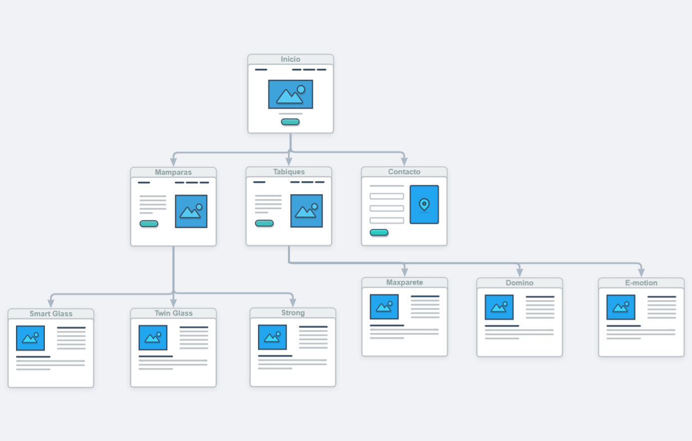
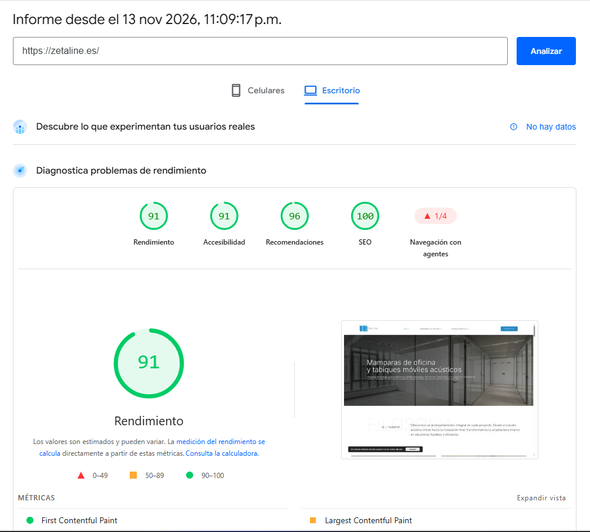

Hay un tipo de empresa que casi siempre tiene la misma web: fabrica algo técnico, lo instala a medida y lo vende a otras empresas. Mamparas, cerramientos, climatización, maquinaria, mobiliario de oficina. Su web es un catálogo con todos los productos, una página de "quiénes somos" y un formulario de contacto al final.

Y casi siempre tiene el mismo problema: la gente entra, no entiende qué necesita y llama para preguntar lo básico. O peor, no llama.

Hace poco diseñé la web de [Zeta Line](/es/portfolio/projects/zetaline-office-partitions-wordpress-elementor/), una empresa de Madrid que fabrica e instala mamparas de oficina y tabiques móviles acústicos. Esto es lo que aplicaría a cualquier web de producto técnico.

---

## Tu web no vende. Orienta.

Nadie compra el tabique móvil de una planta entera directamente desde una web. Lo que pasa en realidad es esto: alguien tiene un problema (una oficina abierta con demasiado ruido, un salón de hotel que necesita dividirse), busca en Google, entra en tres o cuatro webs, compara y le pasa la que más confianza le dio a su arquitecto o a su jefe.

Si tu producto siempre se presupuesta a medida, la web tiene un único trabajo: **llevar a la persona correcta hasta pedir un estudio o un presupuesto**, con la información justa para que se sienta segura al hacerlo.

Todo lo que no ayude a eso sobra.

## Empieza por lo que el cliente sabe, no por lo que tú fabricas

Zeta Line tiene seis sistemas: Smart Glass, Twin Glass, Strong, Maxparete, Domino y E-motion. Para el equipo que los fabrica, la diferencia entre ellos es evidente. Para un director de oficina son seis nombres sin significado.

El error habitual es poner esos seis nombres en el menú y esperar que el cliente elija. No va a pasar.

Lo que hice fue ordenar la web por la pregunta que el cliente sí sabe responder: **¿quieres una división fija o una que se mueva?** Mamparas o tabiques móviles. Dos opciones en vez de seis. Cada una lleva a sus tres sistemas, y cada sistema tiene su propia página.

Si tu catálogo tiene muchos productos, busca la primera decisión que tu cliente puede tomar sin ayuda. Esa es tu navegación.

## Ofrece una segunda puerta: el tipo de espacio

Hay gente que ni siquiera sabe si necesita algo fijo o móvil. Pero sí sabe qué tiene: un hotel, un colegio, un auditorio, una oficina.

Por eso la web tiene también una sección de aplicaciones: oficinas, salas de reuniones, hoteles, colegios, auditorios, restaurantes, eventos y centros de formación. Es otra forma de entrar al mismo catálogo, para quien piensa en su espacio y no en el producto.

## Habla con dos públicos, pero por separado

En un producto técnico casi siempre hay dos personas en la decisión:

- **Quien tiene el problema.** Necesita saber para qué sirve cada cosa, cómo se verá y si le va a resolver el ruido o el espacio.
- **Quien lo especifica.** Arquitectos, interioristas, ingenieros. No quieren que les vendas nada. Quieren fichas técnicas, acabados, detalles constructivos y manuales de instalación.

Si mezclas los dos discursos en la misma página, el primero se pierde entre datos y el segundo se aburre con frases comerciales. En Zeta Line, las páginas de producto empiezan por el uso y dejan lo técnico para abajo, y los arquitectos tienen su propia sección de documentación.

## Responde las preguntas antes de que te llamen

Pregúntale a tu equipo comercial qué les preguntan todas las semanas. Esas respuestas van en la web.

En este caso: cuál es la diferencia entre los tres tipos de mampara, cuánto aíslan del ruido, qué acabados hay, si se puede cambiar la distribución más adelante y en qué tipo de espacios se instalan los tabiques. Cada pregunta respondida es una duda menos antes de pedir el presupuesto. Y de paso, son búsquedas reales en Google.

## Pide una sola cosa

Muchas webs B2B tienen cinco llamadas a la acción distintas: descarga el catálogo, suscríbete, síguenos, contáctanos, pide una demo. Al final no se hace ninguna.

Si lo que vendes siempre se presupuesta a medida, el primer paso real es el estudio. Así que en Zeta Line hay una sola acción en todas las páginas, **"Solicitar estudio"**, con llamada y WhatsApp como alternativa para quien prefiere hablar.

## Que las fotos no hagan lenta la web

Los productos de arquitectura interior se venden con fotografía. Espacios terminados, vidrio, luz. El problema es que una web llena de fotos grandes es una web lenta, y una web lenta pierde gente antes de que vea nada.

La web de Zeta Line saca **91 en rendimiento y 100 en SEO** en PageSpeed Insights (en escritorio), y la mayor parte del contenido son fotos. Una puntuación así no sale sola:

- Optimiza cada imagen antes de subirla. Una foto sacada directa de la cámara puede pesar más que todo el resto de la página.
- Escribe textos alternativos descriptivos. Ayudan a la accesibilidad y llevan las fotos de tus proyectos a Google Imágenes.
- Configura Google Search Console y envía el sitemap, para que Google encuentre todas las páginas de producto desde el primer día.
- Si tienes una sede física, crea tu perfil de Google Business. En una empresa local, muchas veces el primer contacto llega por ahí.

En móvil la puntuación de una web así siempre baja, y no lo voy a esconder: es el siguiente punto a mejorar.

## Una página por producto, una búsqueda por página

Esto es lo que más se descuida en SEO para empresas industriales. Si todos tus productos están en una sola página de catálogo, Google no sabe para qué búsqueda mostrarla.

Cada sistema tiene su propia URL, su título y su descripción, pensados para una búsqueda concreta: "mamparas de oficina", "tabiques móviles acústicos" o el nombre del propio sistema, que también se busca. La página de categoría agrupa los tres y enlaza a cada uno. Así nadie aterriza en una página genérica y tiene que volver a buscar.

## En resumen

Si tienes una web de producto técnico y tus clientes siguen llamando para preguntar lo básico, el problema casi nunca es el diseño. Es el orden en que cuentas las cosas:

1. Primero la decisión que el cliente sabe tomar.
2. Luego el producto, explicado por su uso.
3. Los datos técnicos para quien los busca, aparte.
4. Las dudas de siempre, resueltas.
5. Una sola acción.

Puedes ver cómo quedó todo en el [caso de estudio de Zeta Line](/es/portfolio/projects/zetaline-office-partitions-wordpress-elementor/). Y si tu web tiene este problema, [escríbeme](/es/contact/) y lo revisamos.
